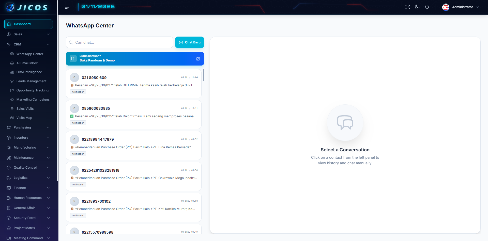
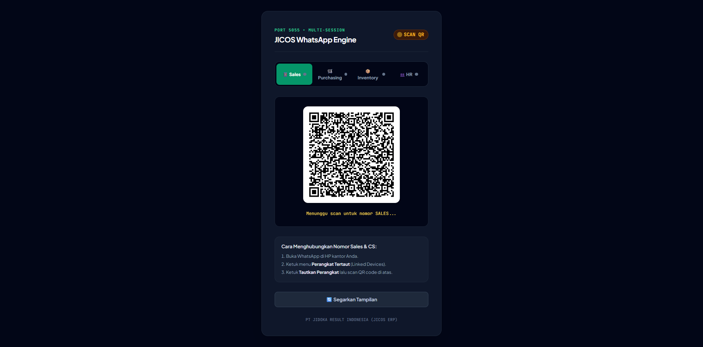
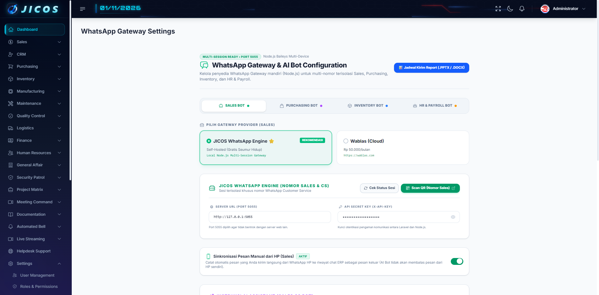
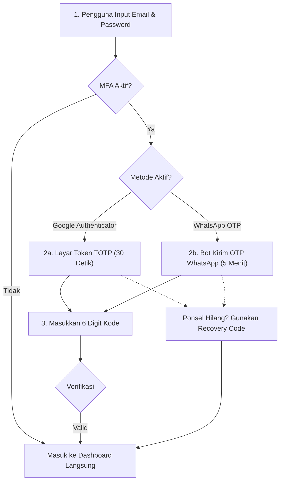

# 📖 PANDUAN PENGGUNA RESMI: WHATSAPP CENTER & GATEWAY ENGINE (JICOS ERP)
**Standar Operasional Prosedur (SOP) Komunikasi Pelanggan, Supplier, dan Internal Karyawan**

---

## 1. 🎯 Ringkasan Modul
Modul **WhatsApp Center & Gateway Engine** berfungsi sebagai pusat komunikasi resmi PT Jidoka Result Indonesia (JIDOKA) / JICOS ERP untuk melayani pesan masuk dan keluar secara terpusat bagi divisi **Sales (Customer Service)**, **Purchasing (Supplier)**, dan **HR (Karyawan Internal)** secara aman, cepat, dan transparan.

Modul ini mendukung penggunaan nomor WhatsApp fisik di HP kantor bersamaan dengan dashboard ERP tanpa saling menimpa atau memicu pesan duplikat.

---

## 2. 🔄 Diagram Alur Kerja Komunikasi & Sinkronisasi

```mermaid
flowchart TD
    subgraph Pelanggan / Vendor
        Cust["Pelanggan / Vendor Kirim WA"]
    end

    subgraph JICOS WhatsApp Gateway (Port 5055)
        Engine["JICOS Engine Multi-Session"]
    end

    subgraph Dashboard ERP
        Center["WhatsApp Center (Sales / Purchasing / HR)"]
    end

    subgraph HP Kantor Fisik
        Phone["Operator Balas Langsung Lewat HP"]
    end

    Cust -->|Pesan Masuk| Engine
    Engine -->|Webhook Realtime| Center
    Center -->|Staff Balas via Web ERP| Engine
    Engine -->|Kirim ke Customer| Cust

    Phone -.->|Ketik Balasan di WA HP| Engine
    Engine -.->|fromMe: true (Sync Aktif)| Center
    Center -.->|Tampil dengan Label| Badge["📱 VIA HP (Read otomatis)"]
```

---

## 3. 👥 Panduan Langkah Demi Langkah per Peran (Role-Based Guide)

### A. 💼 Peran: Staff Sales & Customer Service (CS)

#### 1. Membuka Dashboard WhatsApp Center
1. Masuk ke aplikasi JICOS ERP.
2. Pada menu navigasi sebelah kiri, pilih menu **Sales** > **WhatsApp Center**.
3. Di panel kiri, Anda akan melihat daftar percakapan aktif diurutkan berdasarkan pesan terbaru.



#### 2. Memulai Chat Baru dengan Pelanggan
1. Klik tombol **`+ Chat Baru`** di bagian atas daftar kontak.
2. Cari nama pelanggan (*Customer*) dari daftar dropdown atau ketik nomor telepon pelanggan (contoh: `08123456789`).
3. Ketik pesan Anda pada kotak input di bagian bawah, lalu klik ikon **Kirim** (atau tekan `Enter`).

#### 3. Mengirim Dokumen atau Gambar
1. Klik ikon **Klip Kertas (Lampiran)** di sebelah kiri kotak input pesan.
2. Pilih file dari komputer Anda (Format yang didukung: PDF penawaran harga, gambar spesifikasi pipa, invoice, atau katalog produk).
3. Anda dapat menambahkan catatan/keterangan (*caption*), lalu klik **Kirim**.

#### 4. Menangani Pesan Gagal & Menggunakan Tombol "Kirim Ulang"
Jika koneksi internet sempat terganggu atau nomor tujuan tidak aktif sementara:
1. Bubble pesan yang gagal akan otomatis ditandai dengan badge merah **`⚠️ Gagal Terkirim`**.
2. Tombol **`Kirim Ulang`** berwarna biru akan muncul tepat di samping pesan tersebut.
3. Klik tombol **`Kirim Ulang`** untuk mencoba mengirim kembali tanpa perlu mengetik ulang isi pesan.

#### 5. Memahami Badge "📱 VIA HP"
- Jika rekan Anda membalas chat pelanggan langsung dari HP kantor menggunakan aplikasi WhatsApp biasa:
- Pesan tersebut akan otomatis tersinkronisasi ke dashboard ERP dan diberi penanda **`📱 VIA HP`**.
- Pesan masuk pelanggan sebelumnya akan otomatis ditandai **Sudah Terbaca** (*Read*).

---

### B. 🛒 Peran: Staff Purchasing & Vendor Relations

#### 1. Berkomunikasi dengan Supplier
1. Buka menu **Purchasing** > **Purchasing WA Center**.
2. Sistem akan menampilkan nomor-nomor kontak supplier yang terdaftar pada master vendor.
3. Kirimkan konfirmasi Purchase Order (PO), permintaan penawaran (RFQ), atau jadwal pengiriman material langsung dari dashboard.

#### 2. Sinkronisasi Negosiasi HP ke Sistem
- Seluruh riwayat obrolan negosiasi harga atau jadwal pengiriman yang Anda ketik langsung di HP operasional purchasing akan tercatat di riwayat ERP sebagai bukti audit operasional.

---

### C. 👥 Peran: Staff HR & Internal Payroll

#### 1. Berkomunikasi dengan Karyawan
1. Buka menu **HR** > **HR WhatsApp Center**.
2. Dashboard ini secara khusus menautkan nomor telepon ke data master Karyawan (**NIK, Nama Lengkap, dan Departemen**).
3. Anda dapat menyampaikan pemberitahuan kehadiran, notifikasi cuti, atau klarifikasi data lembur langsung ke WhatsApp karyawan secara personal.

---

### D. 🛠️ Peran: IT Administrator / SuperAdmin

#### 1. Menghubungkan Nomor WhatsApp Baru (QR Pairing)
Untuk menghubungkan nomor WhatsApp baru atau memperbarui sesi yang terputus:
1. Buka browser dan akses URL: **`http://localhost:5055/qr`** (atau `http://ip-server:5055/qr`).
2. Pilih tab modul yang ingin dihubungkan (**Sales**, **Purchasing**, **Inventory**, atau **HR**).
3. Buka WhatsApp di HP kantor > ketuk **Perangkat Tertaut** > **Tautkan Perangkat**.
4. Arahkan kamera HP ke QR Code pada layar hingga status berubah menjadi **ONLINE** (Warna Hijau).



#### 2. Mengatur Toggle Sinkronisasi HP per Modul
Untuk mengaktifkan atau menonaktifkan fitur sinkronisasi balasan HP:
1. Buka menu **Settings** > **WhatsApp Gateway**.
2. Pada bagian pengaturan masing-masing modul, Anda dapat mengatur toggle:
   - **`Sinkronisasi Pesan Keluar dari HP (Outgoing Sync)`**:
     - **AKTIF (ON):** Balasan manual dari HP kantor akan dicatat ke dalam chat history ERP.
     - **NON-AKTIF (OFF):** Pesan yang diketik dari HP kantor tidak akan masuk ke database ERP (hanya pesan dari dashboard ERP yang dicatat).
3. Klik **Simpan Pengaturan**.



#### 3. Pemeliharaan Database & Archiving Otomatis
Sistem dilengkapi command otomatis untuk mencegah database membengkak:
- Secara otomatis berjalan setiap **Minggu pukul 02:00 dini hari**.
- Untuk menjalankan simulasi pembersihan manual dari terminal:
  ```bash
  php artisan erp:archive-old-logs --days=180 --dry-run
  ```
- Untuk mengeksekusi pembersihan log di atas 180 hari:
  ```bash
  php artisan erp:archive-old-logs --days=180
  ```

---

## 4. ❓ Pertanyaan yang Sering Diajukan (FAQ & Troubleshooting)

### Q1: Mengapa pesan saya bertanda "⚠️ Gagal Terkirim"?
**Penyebab Umum:**
1. Nomor WhatsApp penerima tidak valid atau tidak terdaftar di WhatsApp.
2. HP kantor yang terhubung ke Gateway sedang kehabisan baterai atau tidak memiliki koneksi internet.
3. Server Gateway WhatsApp (port 5055) sedang dalam proses restart.  
**Solusi:** Pastikan HP kantor online, lalu klik tombol **`Kirim Ulang`** pada bubble chat tersebut.

### Q2: Apakah balasan operator dari HP akan memicu balasan bot AI otomatis?
**Tidak.** Sistem WhatsApp Engine secara cerdas membedakan pesan pelanggan (`fromMe: false`) dan pesan keluar dari HP kantor (`fromMe: true`). Balasan dari HP Anda tidak akan memicu auto-reply bot AI, sehingga percakapan dengan pelanggan tetap alami dan aman.

### Q3: Bagaimana jika nomor WhatsApp kantor ingin diganti dengan nomor baru?
1. Buka halaman QR Pairing di `http://localhost:5055/qr`.
2. Klik tombol merah **`Putuskan Sesi`**.
3. Sistem akan membuat QR Code baru dalam 2–3 detik.
4. Scan QR Code tersebut menggunakan nomor WhatsApp baru kantor Anda.

### Q4: Apakah data chat lama akan hilang jika server direstart?
**Tidak.** Seluruh riwayat pesan tersimpan aman di database utama ERP (`whatsapp_messages`) dan sesi WhatsApp tersimpan terenkripsi di folder `whatsapp-engine/auth_info_baileys/`. Saat komputer atau server dinyalakan ulang, engine akan otomatis tersambung kembali ke WhatsApp tanpa perlu scan ulang.

---

## 5. 🔐 PANDUAN PENGGUNA: MULTI-FACTOR AUTHENTICATION (MFA)
**Standar Keamanan Akses ISO 27001 (A.9.4.2 Secure Log-on Procedures) & RFC 6238**

Fitur Multi-Factor Authentication (MFA) memberikan lapisan perlindungan ganda pada akun pengguna. Setiap staf JICOS ERP dapat memilih metode keamanan yang paling sesuai:
1. **Google Authenticator (TOTP)**: Bekerja 100% *offline*, perputaran token 30 detik tanpa memerlukan pulsa atau sinyal seluler di pabrik.
2. **WhatsApp OTP**: Kode 6-digit instan yang dikirimkan langsung oleh bot resmi JICOS ERP ke nomor WhatsApp pribadi Anda.

### A. 📱 Alur Kerja Verifikasi Login MFA



### B. 🛠️ Cara Mengaktifkan Google Authenticator (TOTP)
1. **Buka Menu Profil**: Klik nama/avatar Anda di pojok kanan atas dashboard, lalu pilih menu **Profil Saya**.
2. **Buka Pengaturan MFA**: Pada kartu **Autentikasi Multi-Faktor (MFA)**, klik tombol **`Aktifkan MFA Sekarang`**.
3. **Pilih Tab Google Authenticator**:
   - Sistem akan menampilkan **QR Code** aman di layar Anda.
4. **Scan QR Code di Ponsel**:
   - Buka aplikasi **Google Authenticator**, **Microsoft Authenticator**, atau **1Password** di HP Anda.
   - Ketuk tanda tambah (`+`) lalu pilih **Scan QR Code**, kemudian arahkan kamera ke layar komputer.
   - *Alternatif manual:* Anda juga dapat menyalin **Kunci Manual** yang tertera jika kamera HP tidak dapat memindai.
5. **Konfirmasi Kode**:
   - Masukkan 6 digit angka yang muncul pada aplikasi authenticator Anda ke dalam kotak verifikasi.
   - Klik **`Verifikasi & Aktifkan Google Authenticator`**.
6. **Simpan Recovery Codes**:
   - Jendela pop-up akan menampilkan **8 Kode Pemulihan Darurat**. Klik **`Salin Semua Kode`** dan simpan di tempat yang aman.

### C. 📲 Cara Mengaktifkan WhatsApp OTP (Alternatif)
1. Pada modal aktivasi MFA di menu Profil, klik tab **`WhatsApp OTP`**.
2. Masukkan nomor WhatsApp aktif Anda (contoh: `08123456789`).
3. Klik **`Kirim Kode Verifikasi ke WhatsApp`**.
4. Buka WhatsApp Anda, lalu masukkan 6 digit kode yang dikirimkan bot JICOS ERP ke kotak verifikasi.
5. Klik **`Verifikasi & Aktifkan`**.

### D. 🔑 Cara Login Saat MFA Aktif
1. Masukkan email dan password Anda di halaman login seperti biasa.
2. Anda akan otomatis diarahkan ke halaman verifikasi:
   - Jika menggunakan **Google Authenticator**: Cukup buka aplikasi di HP dan masukkan 6 digit token yang sedang aktif.
   - Jika menggunakan **WhatsApp**: Buka chat WhatsApp dari JICOS ERP dan masukkan 6 digit OTP.
3. Kotak input dilengkapi fitur **Auto-Focus** dan **Paste** langsung.
4. Klik **`Verifikasi & Masuk`**.

### E. 🆘 Apa yang Harus Dilakukan Jika Ponsel Hilang?
1. Pada layar verifikasi login, klik tombol tautan **`Ponsel Hilang / Tidak Aktif? Gunakan Kode Pemulihan`**.
2. Masukkan salah satu dari 8 kode pemulihan cadangan Anda (contoh: `AB12C-34D5E`).
3. Anda akan langsung dapat masuk ke akun.
4. *Catatan Keamanan:* Setiap kode cadangan hanya berlaku **1 (satu) kali**. Jika kode Anda hampir habis, klik tombol **`Buat Ulang Kode Cadangan`** di menu Profil Anda.

### F. 🔄 Mengganti Metode atau Menonaktifkan MFA
- **Mengganti Metode**: Pada menu Profil, klik tombol **`Ganti ke WhatsApp`** atau **`Ganti ke Authenticator`** kapan saja tanpa perlu menonaktifkan akun.
- **Menonaktifkan MFA**: Klik tombol merah **`Nonaktifkan MFA`**, lalu masukkan kata sandi akun Anda sebagai konfirmasi.

---

*Dokumen ini diterbitkan oleh Tim Digitalisasi PT Jidoka Result Indonesia (JIDOKA) / JICOS ERP.*
