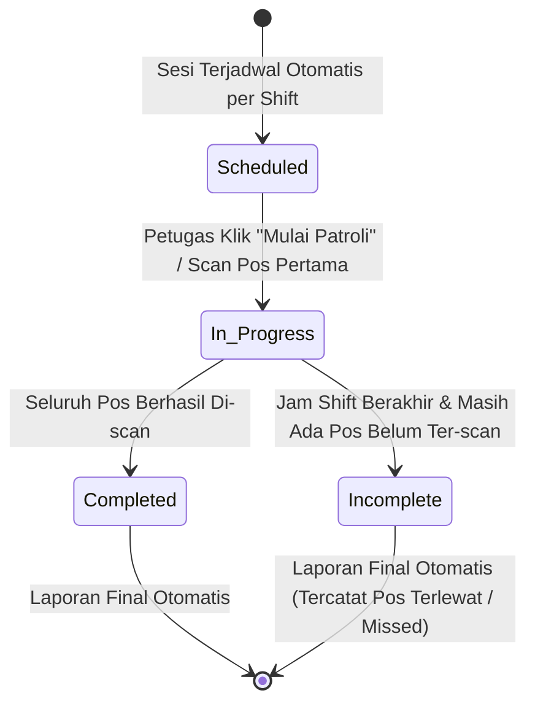

# 📄 Product Requirements Document (PRD) — Final Agreed
## Modul: Digital Security Patrol & Guard Tour System (Patroli Satpam Terintegrasi)

---

### 1. 🎯 Problem & Business Goal

#### A. Latar Belakang & Masalah:
* **Pengawasan Fisik Konvensional Tidak Terukur**: Patroli satpam manual tanpa pelacakan digital membuat manajemen kesulitan mengetahui apakah pos-pos vital (gudang B3, panel listrik, gerbang belakang, pagar batas) benar-benar dicek sesuai jadwal shift.
* **Kebutuhan Rekapitulasi & Visualisasi Data**: Manajemen memerlukan menu **Resume Patrol** (rekapitulasi log patroli per shift/harian) dan **Grafik Analitik** (kepatuhan patroli, tren insiden, pos yang sering terlewat) untuk evaluasi kinerja keamanan.
* **Integrasi Penanganan Cepat Temuan**: Temuan bahaya fisik (lampu mati, kawat berduri rusak, kebocoran) harus otomatis menjadi tiket perbaikan ke divisi *General Affair* (GA).

#### B. Keputusan Bisnis Terpilih:
1. **Rute Bebas / Fleksibel**: Petugas tidak diwajibkan berkeliling secara berurutan (tidak harus pos 1 ➔ 2 ➔ 3). Yang terpenting adalah **seluruh titik target terselesaikan dalam jendela waktu shift yang ditentukan**.
2. **Konektivitas Sinyal HP (Online-First)**: Memanfaatkan koneksi data seluler petugas secara langsung untuk sinkronisasi real-time.
3. **Dual Validation dengan Geofence Adaptif**: Toleransi radius GPS 30–50 meter. Jika petugas berada di bawah kanopi/atap baja dan sinyal GPS melayang, sistem memberikan toleransi bersyarat: petugas tetap dapat menyimpan log titik dengan kewajiban mengambil foto langsung dari kamera (dicatat sebagai *GPS Deviation Flag*).
4. **Finalisasi Otomatis**: Saat seluruh titik ter-scan atau waktu shift berakhir, sesi patroli langsung ditutup otomatis (*Completed* atau *Incomplete/Missed*) dan langsung menjadi laporan final tanpa birokrasi approval manual Danru.
5. **Menu Mandiri Khusus**: Modul ditempatkan pada menu utama tersendiri di sidebar (**Security Patrol**) terpisah dari General Affair.

---

### 2. 👥 User Roles & Permissions (RBAC)

| Role | Hak Akses Utama |
| :--- | :--- |
| **Security Guard (Petugas Lapangan)** | • Menjalankan patroli aktif via mobile: Scan QR Code di titik pos.<br>• Memilih status cepat ("Kondisi Aman" / "Ada Temuan").<br>• Mengambil foto kondisi pos / foto insiden temuan langsung dari kamera HP.<br>• Melihat sisa titik yang belum dikunjungi pada shift-nya. |
| **Danru / Chief Security (Supervisor)** | • Memantau Live Map & status patroli yang sedang berjalan.<br>• Mengatur jadwal shift patroli & target titik.<br>• Melihat Resume Patrol dan ekspor laporan harian (Excel/PDF).<br>• Menerima notifikasi otomatis jika ada temuan insiden kritis. |
| **GA Manager / Super Admin** | • Mengelola Master Titik Patroli (GPS, nama pos, token QR).<br>• Mencetak kartu/stiker QR Code tahan cuaca.<br>• Memantau Dashboard Grafik & Analitik Kepatuhan Keamanan.<br>• Mengelola integrasi tiket otomatis ke GA Tickets. |

---

### 3. 🔄 User Flow & State Machine

#### A. Alur Operasional Patroli:
```mermaid
flowchart TD
    A[Petugas Buka Menu 'Patroli Aktif' di HP] --> B[Sistem Cek Jadwal Shift Aktif]
    B --> C[Tekan 'Mulai Patroli']
    C --> D[Kunjungi Salah Satu Titik Pos]
    D --> E[Scan QR Code via Kamera HP]
    E --> F{Hitung Jarak GPS Satpam ke Master Pos}
    F -->|Jarak <= 50 meter| G[Lokasi Valid: Hijau]
    F -->|Jarak > 50 meter (Atap/Gudang)| H[Toleransi Bersyarat: Wajib Ambil Foto Pos Langsung]
    G --> I[Pilih: Aman / Ada Temuan]
    H --> I
    I -->|Ada Temuan / Kerusakan| J[Input Foto + Deskripsi ➔ Buat Otomatis Tiket GA]
    I -->|Kondisi Aman| K[Simpan Checkpoint Log: Sukses]
    J --> K
    K --> L{Apakah Masih Ada Titik Belum Ter-scan?}
    L -->|Ya| D
    L -->|Semua Titik Selesai ATAU Jam Shift Berakhir| M[Finalisasi Otomatis: Selesai]
    M --> N[Tercatat di Menu 'Resume Patrol' & Update 'Grafik Analitik']
```

#### B. State Machine Sesi Patroli:


---

### 4. 📋 Struktur Menu & Submenu (5 Submenu Terstruktur)

Menu Sidebar Utama: **Security Patrol** (Ikon: `ShieldCheckIcon`)
1. **Live Map & Monitor** (`/security-patrol/map`):
   * Tampilan peta interaktif Leaflet: Pin pos patroli dengan indikator warna real-time (Hijau = Selesai, Kuning = Belum Dikunjungi, Oranye = Ada Temuan).
   * Polyline jejak perpindahan satpam dari pos ke pos.
   * Ringkasan status patroli hari ini secara sekilas.
2. **Sesi & Jadwal** (`/security-patrol/schedules`):
   * Jadwal patroli terikat shift (Pagi, Siang, Malam).
   * Tombol pintas untuk petugas: *"Jalankan Patroli Sekarang"* (tampilan mobile responsif dengan scanner kamera).
3. **Resume Patrol** (`/security-patrol/resume`):
   * Tabel rekapitulasi komprehensif riwayat patroli: Tanggal, Shift, Petugas, Total Titik, Titik Terlewati, Titik Missed, Durasi, Jumlah Temuan.
   * Drawer detail: Daftar checkpoint yang dikunjungi, jam scan riil, deviasi jarak GPS, dan foto kondisi pos.
   * Filter pencarian (rentang tanggal, shift, petugas, status).
   * Tombol ekspor resmi ke **Excel** dan **Cetak PDF**.
4. **Grafik & Analitik** (`/security-patrol/analytics`):
   * **KPI Card**: Tingkat Kepatuhan Patroli (*Compliance Rate %*), Rata-rata Durasi Putaran, Total Titik Terlewat (*Missed Points*), Total Temuan Insiden.
   * **Grafik Tren Kepatuhan Mingguan/Bulanan** (Line/Bar Chart).
   * **Grafik Titik Paling Rawan / Sering Terlewat** (Bar Chart).
   * **Distribusi Status Patroli** (Pie/Doughnut Chart: Tepat Waktu vs Terlambat vs Terlewat).
5. **Master Titik & Cetak QR** (`/security-patrol/checkpoints`):
   * CRUD Master Titik: Kode Titik, Nama Pos, Deskripsi Lokasi, Koordinat GPS (Latitude/Longitude via Map Picker), Toleransi Geofence.
   * Generator & Cetak Kartu Label QR Code (layout rapi untuk dicetak di stiker/papan pos).

---

### 5. 🛡️ Database & Keamanan Data (Zero-Slop & Enterprise Standard)

* **Anti-Fraud**: Token QR terenkripsi/hash acak (bukan ID biasa) + pencatatan deviasi GPS + foto watermarked.
* **Audit Trail**: Mencatat `user_id`, `device_info`, `scanned_at`, `lat_actual`, `lng_actual`, `distance_meter`.
* **Soft Deletes**: Tabel checkpoint dan jadwal menggunakan `deleted_at` untuk menjamin integritas data.
* **Database Transactions (ACID)**: Penyelesaian sesi dan pembuatan tiket GA dibungkus transaksi database agar tidak ada data menggantung.
