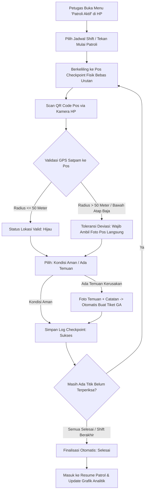

# 📖 Panduan Pengguna (SOP): Digital Security Patrol & Guard Tour System
## Modul Patroli Satpam Terintegrasi Berbasis QR Code & GPS Map Tracking

---

### 1. 🎯 Ringkasan Modul
Modul **Security Patrol** adalah sistem pemantauan dan pencatatan patroli keamanan pabrik secara digital dan terintegrasi. Petugas satpam memvalidasi kehadirannya di setiap titik pos fisik menggunakan **Kamera Pemindai QR Code + Validasi Geolocation GPS**. Seluruh pergerakan dipantau secara langsung melalui **Live Map Command Center**, direkapitulasi otomatis di **Resume Patrol**, serta dianalisis kepatuhannya melalui **Grafik & Analitik**.

---

### 2. 🔄 Diagram Alur Kerja Patroli

---

### 3. 👥 Panduan Operasional per Peran (Role-Based Step-by-Step)

#### A. Petugas Satpam Lapangan (Security Officer / Mobile View)
1. **Membuka Menu Patroli**:
   * Buka browser di smartphone Anda dan login ke sistem ERP.
   * Pada bilah navigasi kiri, pilih menu **Security Patrol > Patroli Aktif (Mobile)**.
2. **Memulai Sesi Patroli**:
   * Pilih jadwal shift yang sedang berjalan (contoh: *Patroli Shift Pagi* atau *Patroli Shift Malam*).
   * Tekan tombol biru besar: **"Mulai Patroli Sekarang"**.
   * Timer durasi patroli akan mulai berjalan otomatis.
3. **Memindai QR Code di Pos Fisik**:
   * Datangi pos fisik di area pabrik (tidak wajib berurutan).
   * Tekan tombol hijau: **"PINDAI QR CODE POS SEKARANG"**.
   * Arahkan kamera ke stiker QR Code yang terpasang di dinding/papan pos.
4. **Pemeriksaan Kondisi Pos**:
   * Pilih tombol **"Kondisi Aman"** jika situasi steril dan aman.
   * Jika ada temuan (misal: pintu darurat terganjal, lampu mati, kawat berduri longgar):
     * Pilih **"Ada Temuan"**.
     * Tulis keterangan temuan di kolom catatan.
     * Ambil foto bukti langsung menggunakan kamera HP.
     * *Catatan:* Sistem akan secara otomatis meneruskan temuan ini menjadi **Tiket General Affair (GA)** agar segera ditindaklanjuti tim teknisi!
   * Tekan **"Simpan Log Pos"**.
5. **Menyelesaikan Patroli**:
   * Begitu titik pos terakhir berhasil di-scan, sesi patroli akan langsung ditutup otomatis (*Completed*).
   * Jika jam shift berakhir sebelum seluruh titik sempat diperiksa, satpam dapat menekan tombol **"Selesaikan Patroli Manual / Waktu Berakhir"**.

---

#### B. Komandan Regu (Danru) & Chief Security (Supervisor / Command Center)
1. **Pemantauan Peta Interaktif (Live Map)**:
   * Buka menu **Security Patrol > Live Map & Monitor**.
   * Perhatikan status warna pin di denah pabrik:
     * 🟢 **Hijau**: Pos sudah diperiksa dan dinyatakan aman.
     * 🟡 **Kuning**: Pos belum dikunjungi pada sesi berjalan.
     * 🔴 / 🟠 **Oranye**: Pos memiliki laporan temuan insiden.
   * Klik pin pos pada peta untuk melihat jam scan aktual, foto bukti, dan deviasi GPS.
2. **Melihat Rekapitulasi (Resume Patrol)**:
   * Buka menu **Security Patrol > Resume Patrol**.
   * Gunakan filter tanggal, shift, status, atau nama satpam untuk melihat ringkasan.
   * Klik tombol **"Detail"** pada baris sesi untuk membuka drawer rincian log checkpoint dan foto fisik pos.
   * Tekan tombol **"Ekspor Excel"** untuk mengunduh laporan rekapitulasi resmi format `.csv` / Excel.
3. **Evaluasi Kepatuhan (Grafik & Analitik)**:
   * Buka menu **Security Patrol > Grafik & Analitik**.
   * Pilih rentang waktu (7 Hari, 14 Hari, atau 30 Hari).
   * Analisis metrik:
     * **Tingkat Kepatuhan (%)**: Persentase sesi yang menyelesaikan 100% pos tepat waktu.
     * **Rata-rata Durasi**: Kecepatan keliling satpam dalam satuan menit.
     * **Pos Paling Sering Terlewat (Top Missed)**: Mengidentifikasi pos yang sering diabaikan satpam (misal pos perimeter belakang).

---

#### C. Tim General Affair & Administrator
1. **Mengelola Master Pos Checkpoint**:
   * Buka menu **Security Patrol > Master Titik & Cetak QR**.
   * Tekan tombol **"Tambah Titik Pos"** untuk mendaftarkan pos baru:
     * Isi Kode Pos (contoh: `CP-11`).
     * Isi Nama Pos & Zona Area (contoh: `Gudang Limbah Scrap`).
     * Masukkan koordinat Latitude & Longitude GPS (dapat diambil via GPS ponsel di lokasi).
     * Atur toleransi geofence (standar: 50 meter).
     * Masukkan daftar SOP checklist pos (1 baris per pertanyaan).
2. **Mencetak Label QR Code Stiker (Format Pas 6/Lembar A4)**:
   * Pada halaman Master Titik, tekan tombol **"Cetak Semua Label QR (6/Lembar)"** (atau tekan *"Cetak QR"* pada pos tertentu).
   * Pratinjau akan menampilkan kartu label QR lengkap dengan **Logo Perusahaan Resmi**, Kode Pos tebal, Nama Pos, dan QR Code terpusat.
   * Tekan tombol **"Cetak Sekarang (Print A4)"**.
   * Format cetak telah disesuaikan agar **tepat 6 kartu per 1 lembar A4** (2 kolom x 3 baris) tanpa terpotong di tepi kertas.

---

### 4. 📸 Dokumentasi Visual Antarmuka Sistem

#### A. Live Map Command Center (Denah Pabrik & Pin Pos):

#### B. Antarmuka Mobile Satpam (Scan QR & Checklist Lapangan):

#### C. Pratinjau Cetak Label QR (Pas 6 per Lembar A4 dengan Logo Perusahaan):

#### D. Resume Patrol (Tabel Rekapitulasi & Ekspor Excel):

#### E. Grafik & Analitik Kepatuhan Keamanan:

#### F. Master Titik Pos & Pengaturan Jadwal:

---

### 5. ❓ FAQ & Panduan Kendala Operasional (Troubleshooting)

1. **Bagaimana jika satpam berada di bawah kanopi baja atau gudang tertutup sehingga sinyal GPS meleset?**
   * Sistem kami dirancang dengan **Toleransi GPS Bersyarat**. Jika jarak GPS satpam terdeteksi > 50 meter dari titik master karena atap seng/baja, sistem akan meminta satpam untuk mengambil foto fisik pos langsung dari kamera ponsel. Log scan tetap akan tersimpan dengan penanda *(GPS Deviasi)* tanpa memblokir pekerjaan satpam.
2. **Bagaimana jika stiker QR Code di pos robek atau pudar terkena hujan?**
   * Danru atau GA dapat mencetak ulang stiker pos tersebut dari menu **Master Titik & Cetak QR > Cetak QR**.
   * Jika ada indikasi kebocoran kode QR, tekan tombol **Rotasi Token QR** untuk memperbarui kode keamanan uniknya.
3. **Apakah satpam bisa mengunggah foto lama dari galeri HP?**
   * Tidak. Tombol pengambilan foto diatur menggunakan atribut `capture="environment"`, sehingga browser ponsel secara otomatis membuka kamera langsung (*direct camera capture*) untuk menjamin keaslian foto kondisi lapangan saat itu juga.
4. **Ke mana laporan kerusakan/insiden diteruskan?**
   * Setiap log pos yang ditandai sebagai *"Ada Temuan"* akan otomatis dibuatkan dokumen **`GaTicket`** baru di modul General Affair dengan prioritas *High*, lengkap dengan foto bukti dan nama pelapor sehingga tim teknisi dapat segera melakukan perbaikan.
