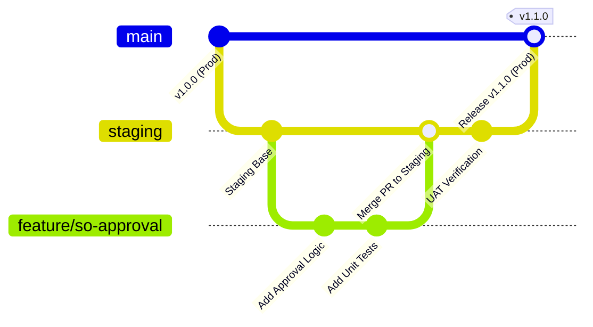
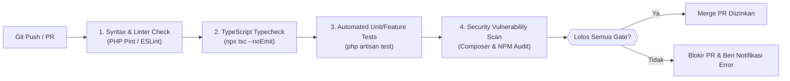
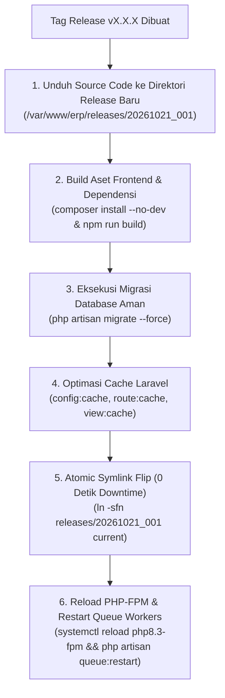

# 🚀 Panduan CI/CD & Manajemen Rilis Produksi (Release Management SOP)
> **Sistem**: ERP Terpadu (Manufaktur, Distribusi & Operasional)  
> **Versi**: 1.0 (Enterprise Specification)  
> **Standar**: Zero-Downtime Deployment, Automated Quality Gates, Safe Database Migrations  

---

## 1. Strategi Pencabangan Git (Git Branching Model)

Untuk mencegah kode yang belum teruji masuk ke server produksi, digunakan alur kerja *Trunk-Based / GitFlow Terkendali*:



1. **`main` (Production)**:
   - Branch stabil 100%. Hanya dapat diperbarui melalui *Pull Request (PR)* dari branch `staging` yang telah lulus seluruh pengujian otomatis dan UAT.
   - Dilindungi (*Protected Branch*): Dilarang melakukan *force push* atau *direct commit*.
2. **`staging` (Pre-Production / UAT)**:
   - Lingkungan simulasi identik dengan server produksi. Digunakan untuk verifikasi tim QA dan pengujian pengguna akhir (*Key User Testing*).
3. **`feature/*` atau `fix/*` (Development)**:
   - Branch kerja developer untuk penambahan fitur atau perbaikan bug.

---

## 2. Gerbang Kualitas Otomatis (Automated Quality Gates - CI)

Sebelum sebuah *Pull Request* diizinkan untuk di-merge ke branch utama, pipeline Continuous Integration (CI) di GitHub Actions wajib menjalankan verifikasi berikut:



### Skrip Verifikasi Mandiri Sebelum Commit:
```bash
# 1. Periksa Integritas Tipe Frontend
npm run typecheck # atau npx tsc --noEmit

# 2. Periksa Format Kode
./vendor/bin/pint --test

# 3. Jalankan Pengujian Backend
php artisan test --parallel
```

---

## 3. Alur Rilis Nir-Downtime (Zero-Downtime Deployment - CD)

Dalam lingkungan enterprise, proses rilis pembaruan dilarang memutus sesi pengguna atau menyebabkan layar blank pada jam operasional:



### Keunggulan Metode Atomic Symlink:
- Selama aset dikompilasi, pengguna tetap mengakses versi lama di folder `current`.
- Saat versi baru siap, symlink diarahkan dalam waktu kurang dari 1 milidetik (*Instantaneous*).

---

## 4. Keamanan Migrasi Basis Data (Database Migration Safety Rules)

1. **Dilarang Menjalankan Perintah Destruktif**:
   - Perintah `php artisan migrate:fresh`, `db:wipe`, atau perintah SQL `DROP TABLE` **DILARANG KERAS** di lingkungan produksi.
2. **Backward-Compatible Migrations**:
   - Jika ingin mengubah nama kolom (*rename column*): Tambahkan kolom baru terlebih dahulu, migrasikan data, baru hapus kolom lama pada rilis versi berikutnya (fase bertahap).
3. **Pencadangan Wajib Sebelum Migrasi**:
   - Pipeline deployment wajib mengeksekusi backup cepat (*snapshot dump*) sebelum menjalankan `php artisan migrate --force`.

---

## 5. Prosedur Pembalikan Instan (Instant Rollback Runbook)

Jika terjadi *unhandled fatal error* atau regresi kritis setelah rilis:

```bash
# 1. Arahkan kembali symlink ke rilis sebelumnya
cd /var/www/erp
ln -sfn releases/PREVIOUS_STABLE_RELEASE current

# 2. Segarkan Cache Aplikasi
cd current
php artisan optimize:clear
php artisan optimize

# 3. Restart Pekerja Antrian (Queue Workers)
php artisan queue:restart
systemctl reload php8.3-fpm
```
*Waktu eksekusi rollback: < 30 detik tanpa kehilangan data transaksi pengguna.*
