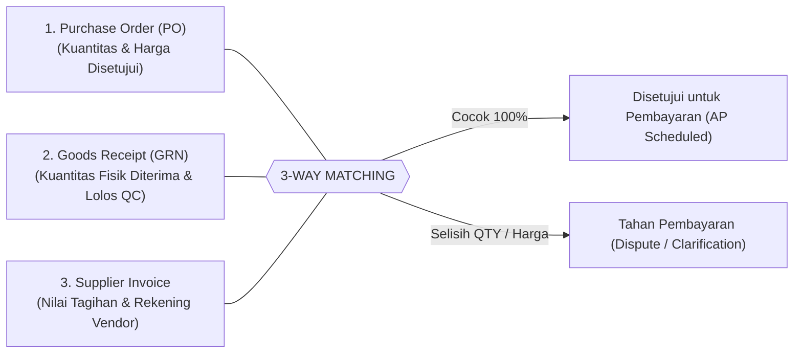

# 📐 Spesifikasi Fungsional Rinci & Aturan Bisnis (Detailed Functional Specification - FSD)
> **Sistem**: ERP Terpadu (Manufaktur, Distribusi & Operasional)  
> **Versi**: 1.0 (Enterprise Specification)  
> **Target Pengguna**: Tim Pengembang, Implementator, Tim QA, Auditor Sistem  

---

## 1. Modul Penjualan & Distribusi (Sales & Distribution)

### 1.1 Siklus Validasi Pesanan (Sales Order)
1. **Pemeriksaan Batas Kredit (Credit Limit Check)**:
   - Sebelum Sales Order (SO) dapat berstatus `approved`, sistem secara otomatis memeriksa total saldo piutang berjalan (*Outstanding Accounts Receivable*) + nilai pesanan saat ini terhadap batas kredit pelanggan (`customers.credit_limit`).
   - Jika melebihi batas kredit, sistem mengunci dokumen dan mewajibkan eskalasi persetujuan khusus dari **Finance Manager / Direktur**.
2. **Reservasi Stok Otomatis (Stock Reservation)**:
   - Saat SO berpindah status ke `confirmed`, sistem otomatis menambah `reserved_qty` pada tabel `product_stocks` sesuai gudang yang ditunjuk.
   - Saldo bebas (`available_qty`) otomatis berkurang agar barang tersebut tidak dijual oleh staf sales lain secara bersamaan.
3. **Surat Jalan Parsial (Partial Delivery Order)**:
   - Sistem mendukung penerbitan lebih dari satu Surat Jalan (DO) untuk satu dokumen SO jika kuantitas barang di gudang belum mencukupi untuk pengiriman penuh.
   - Status SO menjadi `in_progress` dan baru berpindah ke `completed` saat akumulasi barang terkirim pada seluruh DO sama dengan kuantitas pesanan.

---

## 2. Modul Pengadaan & Pembelian (Purchasing & Procurement)

### 2.1 Alur Persetujuan Bertingkat (Approval Hierarchy PR & PO)
Penentuan jalur persetujuan Permintaan Pembelian (PR) dan Pesanan Pembelian (PO) didasarkan pada matriks nominal anggaran:

| Rentang Nilai Transaksi (IDR) | Persetujuan Wajib |
|---|---|
| **≤ Rp 5.000.000** | Kepala Departemen Pemohon |
| **Rp 5.000.001 - Rp 50.000.000** | Kepala Departemen + Purchasing Manager |
| **> Rp 50.000.000** | Kepala Departemen + Purchasing Manager + Direktur Keuangan / Utama |

### 2.2 Pencocokan Tiga Arah (3-Way Matching Protocol)
Untuk mencegah pembayaran fiktif atau kelebihan bayar, sistem mewajibkan verifikasi 3 dokumen sebelum Faktur Pembelian (*Purchase Invoice*) disahkan untuk pembayaran:

---

## 3. Modul Pabrikasi & Biaya Pokok Produksi (Manufacturing & Costing)

### 3.1 Struktur Resep Formula (Bill of Materials - BOM)
- BOM mendukung struktur multi-level (Bahan Mentah -> Barang Setengah Jadi/WIP -> Produk Jadi).
- **Komponen Scrap/Susut**: Setiap bahan baku dapat memiliki faktor toleransi penyusutan (*scrap rate percentage*, misal 2%). Kuantitas yang ditarik dari gudang akan otomatis ditambah faktor susut tersebut.

### 3.2 Rumus Kalkulasi Harga Pokok Produksi (HPP / COGS Calculation)
Saat Surat Perintah Kerja (*Work Order*) selesai (*Completed*), sistem menghitung HPP Aktual per unit dengan formula:

$$\text{Unit Cost} = \frac{\sum (\text{Actual Material Cost}) + \text{Actual Direct Labor Cost} + \text{Allocated Machine Overhead}}{\text{Total Good Finished Quantity}}$$

- Nilai barang ditolak (*Rejected Qty*) diserap menjadi beban penyusutan biaya produksi, atau dipindahkan ke akun barang sisa/scrap sesuai konfigurasi jenis produk.

### 3.3 Taksonomi Defek & Barang Cacat
Operator wajib mengklasifikasikan setiap produk cacat ke dalam kategori standar:
1. `dimensional`: Kesalahan ukuran panjang/lebar/diameter.
2. `surface`: Goresan, karat, noda, atau cacat visual cat.
3. `material`: Cacat bahan dasar dari vendor (porositas/keretakan).
4. `assembly`: Kesalahan proses perakitan operator mesin.

---

## 4. Modul Pengendalian Mutu (Quality Control - QC)

### 4.1 Inspeksi Masuk (Incoming Material Inspection)
- Barang yang baru tiba dari supplier melalui Goods Receipt (GRN) berada dalam status karantina (`quarantine`).
- Petugas QC melakukan uji sampling sesuai standar AQL (*Acceptable Quality Limit*):
  - **Lolos (Pass)**: Stok berpindah ke gudang aktif yang siap dijual/diproduksi.
  - **Tolak (Reject)**: Diterbitkan dokumen **NCR (Non-Conformance Report)** dan barang dialihkan ke Gudang Retur untuk proses retur beli (*Purchase Return*).

### 4.2 Penerbitan Sertifikat Analisis (COA)
- Sistem mampu menerbitkan lembar resmi **COA (Certificate of Analysis)** yang mencocokkan hasil uji fisik aktual dengan standar toleransi batas atas/bawah (*Master Inspection Points*). Dokumen dilengkapi QR-Code verifikasi digital.

---

## 5. Modul Keuangan & Integrasi Jurnal Otomatis (Auto-Journaling)

Setiap transaksi operasional secara otomatis memicu jurnal buku besar akuntansi berpasangan (*Double-Entry Bookkeeping*):

| Peristiwa Operasional | Akun Debet | Akun Kredit |
|---|---|---|
| **Penerimaan Barang (GRN Lolos QC)** | Persediaan Barang Mentah (*Inventory Asset*) | Hutang Belum Ditagih (*Unbilled AP Accrual*) |
| **Faktur Vendor Diterima (Purchase Invoice)**| Hutang Belum Ditagih (*Unbilled AP Accrual*) | Hutang Usaha (*Accounts Payable*) |
| **Pengiriman Barang ke Klien (DO Shipped)** | Beban Pokok Penjualan (*COGS*) | Persediaan Barang Jadi (*Inventory Asset*) |
| **Penerbitan Faktur Jual (Sales Invoice)** | Piutang Usaha (*Accounts Receivable*) | Pendapatan Penjualan + PPN Keluaran |
| **Penyelesaian SPK Pabrik (WO Completed)** | Persediaan Barang Jadi (*Finished Goods*) | Barang Dalam Proses (*WIP Clearing*) |

---

## 6. Modul General Affair (GA) & Peminjaman Kendaraan Dinas

### 6.1 Siklus Peminjaman Mobil/Motor Dinas (Vehicle Booking)
1. **Pengajuan (Request)**: Pegawai menginput tanggal pinjam, keperluan dinas, tujuan, dan memilih unit kendaraan yang tersedia.
2. **Persetujuan (Approval)**: Verifikasi oleh GA Officer atau Kepala Departemen pemohon.
3. **Mulai Perjalanan (Start Trip)**: Driver/Pegawai menginput odometer awal (KM Awal) dan mengambil kunci.
4. **Selesai Perjalanan (Complete Trip)**: Pegawai mengembalikan kendaraan, menginput KM Akhir (sistem menghitung selisih jarak riil), dan melampirkan nota pembelian BBM (reimbursement).

---

## 7. Modul Meeting Command & AI Notulensi (MoM)

### 7.1 Presensi Rapat & AI Audio Processing
1. **Presensi Digital Mandiri**: Peserta memindai QR Code di layar utama menggunakan kamera ponsel untuk mencatatkan waktu kehadiran dan divisi.
2. **Pemrosesan Suara Cerdas (AI MoM)**:
   - Rekaman audio rapat diunggah ke backend melalui endpoint /meeting-command/ai-process-audio.
   - Google Gemini API mengekstrak transkrip dan memetakan menjadi 3 output terstruktur:
     - *Ringkasan Eksekutif (Summary)*.
     - *Poin Keputusan Kritis (Key Decisions)*.
     - *Daftar Tindak Lanjut (Action Items)* lengkap dengan PIC dan tenggat waktu.
3. **Papan Tugas (Action Items Board)**: Action items otomatis terhubung ke papan kanban penugasan (*To Do, In Progress, Done*).

---

## 8. Modul Bel Pabrik Otomatis (JICOS Bell Agent)

### 8.1 Protokol Sinkronisasi Audio Bel
1. **Sinkronisasi Berkala**: Daemon Python pps/bell-agent memanggil endpoint /api/bell-agent/schedules setiap 5 menit untuk mengambil jadwal lonceng aktif.
2. **Operasional Offline Resilient**: Jadwal di-cache secara lokal dalam format JSON. Jika koneksi LAN/WiFi terputus, bel tetap berbunyi tepat waktu sesuai waktu jam internal OS.
3. **Prioritas Suara**: Alarm darurat (*emergency chime*) memiliki prioritas pemutaran instan yang membatalkan nada suara reguler.

---

## 9. Modul Supir Pengiriman (Driver Mobile) & Bukti Kirim (POD)

### 9.1 Alur Kerja Supir di Lapangan
1. **Pemindaian Muatan**: Supir membuka aplikasi ponsel di URL /driver, memindai barcode nomor Surat Jalan (DO) menggunakan kamera ponsel untuk validasi barang masuk ke bak truk.
2. **Bukti Pengiriman (Proof of Delivery / POD)**:
   - Saat tiba di lokasi pelanggan, supir menekan tombol *Confirm Arrival*.
   - Mengambil foto bukti serah-terima barang fisik di gudang pelanggan.
   - Meminta tanda tangan digital penerima barang pada layar sentuh.
   - Status DO otomatis berpindah dari shipped menjadi delivered.

---

## 10. Modul Portal Pemasok (External Supplier Portal)

### 10.1 Alur Kolaborasi Tanpa Kertas (Paperless Vendor Collaboration)
1. **Penerimaan Pesanan (PO Acknowledge)**: Vendor menerima notifikasi PO baru dan menekan tombol *Acknowledge* untuk mengonfirmasi komitmen jadwal pengiriman.
2. **Surat Jalan Vendor Mandiri**: Sebelum armada berangkat, vendor menginput nomor surat jalan dan nomor polisi truk langsung di portal, sehingga tim Gudang Penerima sudah memiliki data manifes awal.
3. **Faktur Digital**: Vendor mengunggah file PDF Faktur & Kwitansi tagihan, memicu verifikasi otomatis *3-Way Matching* di modul Purchasing/Finance pabrik.
