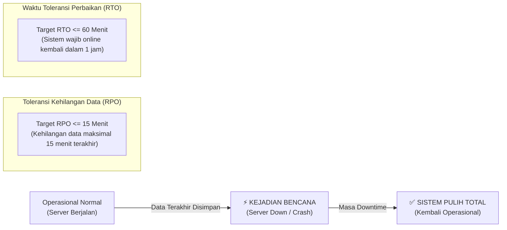

# 🚨 Rencana Pemulihan Bencana & Keberlanjutan Sistem (Disaster Recovery Plan - DRP)
> **Sistem**: ERP Terpadu (Manufaktur, Distribusi & Operasional)  
> **Versi**: 1.0 (Enterprise Specification)  
> **Target Keandalan**: 99.9% Uptime, High Availability, Zero Data Loss Policy  

---

## 1. Definisi Sasaran Pemulihan (RPO & RTO)

Dalam operasional industri dan pabrik, sistem ERP merupakan tulang punggung aktivitas gudang dan produksi. Kerusakan atau kehilangan data akan menghentikan pengiriman barang dan jam kerja shift operator.



| Metrik Pemulihan | Nilai Sasaran | Keterangan Operasional |
|---|:---:|---|
| **RPO (Recovery Point Objective)** | **≤ 15 Menit** | Batas maksimal rentang waktu transaksi yang boleh hilang saat server mati total. Dicapai melalui cadangan *binary logs (binlog)* per 15 menit. |
| **RTO (Recovery Time Objective)** | **≤ 60 Menit** | Batas waktu maksimal tim IT untuk membangkitkan kembali sistem baru hingga pengguna dapat login dan beroperasi. |
| **SLA Ketersediaan (Uptime)** | **≥ 99.9%** | Maksimal total waktu *downtime* tak terencana adalah < 43 menit per bulan. |

---

## 2. Strategi Pencadangan Bertingkat (Multi-Tier Backup Strategy)

Untuk memitigasi risiko ransomware, kerusakan harddisk, atau bencana fisik di pusat data:

```mermaid
flowchart TD
    PROD_DB[("Database Produksi\n(MySQL Primary)")] -->|Tiap Malam (Pkl 01:00)| FULL_DUMP["📦 Full Backup (mysqldump)\n(Kompresi gzip + Enkripsi AES)"]
    PROD_DB -->|Tiap 15 Menit| BINLOG_DUMP["📝 Incremental Binlogs\n(Transaksi Berjalan)"]
    ATTACHMENTS["📁 Berkas Uploads\n(PDF, Foto, Sertifikat QC)"] -->|Tiap Malam (Pkl 02:00)| R_SYNC["📦 Sync Media Files"]

    FULL_DUMP --> LOCAL_VAULT["Lokasi 1: Local Backup Directory\n(/var/backups/erp/ - Retensi 7 Hari)"]
    BINLOG_DUMP --> LOCAL_VAULT
    R_SYNC --> LOCAL_VAULT

    LOCAL_VAULT -->|Upload Terenkripsi S3/Cloud| REMOTE_VAULT["Lokasi 2: Off-site Cloud Storage\n(AWS S3 / Wasabi / Google Cloud)\n(Retensi 30 Hari - Air Gapped)"]
```

### 2.1 Jadwal & Jenis Pencadangan
1. **Full Database Backup**:
   - Dieksekusi otomatis setiap hari pukul **01:00 WIB**.
   - Menghasilkan file dump `.sql.gz` terenkripsi kata sandi.
2. **Incremental Transaction Logs (MySQL Binary Logs)**:
   - Disinkronkan setiap **15 menit** ke direktori cadangan terisolasi.
3. **Pencadangan Berkas Fisik (Storage & Dokumen Transaksi)**:
   - Seluruh folder `storage/app/public` (Surat Jalan PDF, Faktur, Dokumen QC, lampiran vendor) disinkronkan harian ke Cloud Object Storage.

---

## 3. Prosedur Tanggap Darurat Pemulihan (Disaster Recovery Runbook)

### Skenario: Server Utama Terbakar / VPS Corrupt Total
Langkah demi langkah bagi Tim Tanggap Darurat IT:

1. **Deklarasi Status Bencana (Menit 0 - 5)**:
   - IT Lead menerima notifikasi *down* dan memastikan server fisik tidak dapat di-reboot.
   - Mengaktifkan pengumuman status darurat kepada seluruh departemen (Pabrik, Gudang, Sales).
2. **Penyediaan Server Pengganti (Menit 5 - 20)**:
   - Mengaktifkan instance server cadangan (*Failover Node / Standby VPS*) yang telah dipasang *Docker Engine / Environment LEMP*.
3. **Penarikan Berkas Cadangan Terbaru (Menit 20 - 35)**:
   - Mengunduh cadangan *Full Dump* semalam dan *Incremental Binlogs* terakhir dari Cloud Storage.
   ```bash
   # Contoh ekstraksi dan dekripsi backup
   openssl enc -d -aes-256-cbc -in backup_20261021_0100.sql.gz.enc -out backup.sql.gz
   gunzip < backup.sql.gz | mysql -u erp_user -p erp_production
   ```
4. **Sinkronisasi Binlog Terakhir (Menit 35 - 45)**:
   - Melakukan *replay* transaksi 15 menit terakhir sebelum kejadian.
5. **Switching Alamat DNS / IP Failover (Menit 45 - 55)**:
   - Mengubah rute domain Cloudflare / DNS publik ke IP Server Baru (TTL 60 detik).
6. **Verifikasi Sistem & Buka Akses Pengguna (Menit 55 - 60)**:
   - Melakukan uji login, verifikasi saldo stok terakhir, dan membuka sistem untuk pengguna umum.

---

## 4. Arsitektur Pemantauan Kesehatan Sistem (Health Check Architecture)

Sistem menyediakan endpoint diagnostik independen di URL `/api/health` yang dipantau setiap 60 detik oleh sistem monitoring eksternal (misal: UptimeKuma / Datadog / Healthchecks.io).

### Respon Standar Endpoint `/api/health`:
```json
{
  "status": "healthy",
  "timestamp": "2026-10-21T06:00:00Z",
  "environment": "production",
  "checks": {
    "database": {
      "status": "up",
      "latency_ms": 2.4
    },
    "redis_cache": {
      "status": "up",
      "latency_ms": 0.8
    },
    "disk_storage": {
      "status": "up",
      "used_percent": 41.2,
      "free_gb": 128.5
    },
    "queue_workers": {
      "status": "up",
      "pending_jobs": 0,
      "failed_jobs_last_24h": 0
    }
  }
}
```

### Peringatan Otomatis (Alerting Escalation):
- **Warning (Telegram/Email IT)**: Disk storage > 80%, response latency database > 1000ms.
- **Critical (SMS/Panggilan Otomatis IT Lead)**: Database down, status endpoint 500 berturut-turut selama 2 menit.

---

## 5. Simulasi Pemulihan Bencana Berkala (Drill & Testing)

Standar Enterprise mewajibkan simulasi pemulihan berkala (*Disaster Recovery Drill*):
- **Frekuensi**: Sekali setiap **6 bulan (Dua kali setahun)**.
- **Metode**: Menguji restore database acak ke server *staging*, mencocokkan total saldo kas/stok, dan mengukur durasi riil RTO.
- **Dokumentasi**: Hasil pengujian dicatat dalam Berita Acara Simulasi Pemulihan Sistem sebagai bukti kepatuhan audit sistem informasi.
