# 📘 Cetak Biru (Blueprint) Aplikasi ERP

> **Versi**: 1.0  
> **Dibuat**: 7 Maret 2026  
> **Target Pembaca**: Developer (Pengembang), Tim QA (Penguji Kualitas), Manajer Proyek, dan Pemangku Kepentingan  

---

## Daftar Isi
1. [Arsitektur Sistem & Teknologi (Tech Stack)](#1-arsitektur-sistem--teknologi-tech-stack)
2. [Skema Database / ERD](#2-skema-database--erd)
3. [Spesifikasi Modul & Alur Kerja (Workflows)](#3-spesifikasi-modul--alur-kerja-workflows)
4. [Dokumentasi API & Rute URL](#4-dokumentasi-api--rute-url)
5. [Panduan Deployment & Infrastruktur](#5-panduan-deployment--infrastruktur)
6. [Referensi Standar Arsitektur Enterprise](#6-referensi-standar-arsitektur-enterprise)

---

# 1. Arsitektur Sistem & Teknologi (Tech Stack)

## 1.1 Tumpukan Teknologi (Technology Stack)

| Lapisan | Teknologi | Versi / Keterangan |
|---|---|---|
| **Kerangka Kerja Backend** | Laravel (PHP) | v11.x |
| **Kerangka Kerja Frontend** | Vue.js 3 | Composition API (`<script setup>`) |
| **Penghubung (Bridge)** | Inertia.js | Menggantikan pola API + SPA tradisional |
| **Kerangka Kerja CSS** | Tailwind CSS | Dilengkapi komponen kustom seperti `glass-card` |
| **Database** | MySQL | Relasional, Mesin InnoDB |
| **Kompilasi Aset (Build)**| Vite | Untuk optimasi dan kompilasi Frontend |
| **Ikon** | Heroicons | Terintegrasi via `@heroicons/vue` |
| **Ekspor/Impor Excel** | Laravel Excel (Maatwebsite)| Untuk fitur Import & Export |
| **Pembuat PDF** | DomPDF / Snappy | Untuk cetak Invoice, Delivery Order, Quotation |
| **Kecerdasan Buatan (AI)** | Google Gemini API | Diatur lewat `GeminiService.php` |
| **Integrasi WhatsApp** | API Fonnte & Wablas | `FonnteService.php`, `WablasService.php` |
| **E-Meterai Digital** | Integrasi Kustom | Khusus untuk dokumen resmi (`EmeteraiService.php`) |
| **Email** | SMTP + Laravel Mail | Notifikasi dan pengiriman email (`EmailService.php`) |
| **Pelacakan Armada (GPS)** | Traccar Server API | Integrasi satelit posisi armada truk (`TraccarProxyController.php`) |
| **Otomasi Bel Pabrik** | Python Desktop Daemon | Client desktop workshop (`apps/bell-agent`, PyStray, sounddevice) |
| **Pengawasan Visual (CCTV)**| RTSP / HLS Live Stream | Monitoring multi-channel Video Wall (`CctvController.php`) |
| **Biometrik & Face ID** | Canvas Face Recognition | Pendaftaran & presensi nir-sentuh (`EmployeeFaceController.php`) |

## 1.2 Diagram Arsitektur

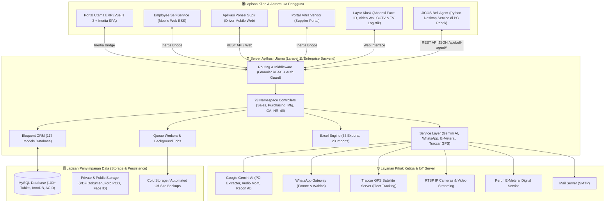

## 1.3 Struktur Folder (Direktori)

```
app/
├── Console/          # Perintah Command Line (Artisan) (7 file)
├── Exports/          # Skrip Pembuatan Excel (63 file)
├── Http/
│   └── Controllers/  # Logika Aplikasi Utama (23 Kategori Namespace)
│       ├── Admin/           # Log Aktivitas & Sistem
│       ├── Api/             # Webhook WhatsApp & Bell Agent API
│       ├── Auth/            # Otentikasi & Sesi
│       ├── CRM/             # Leads, Kampanye, Sales Visits & Intelligence
│       ├── Driver/          # Antarmuka Ponsel Supir Logistik
│       ├── Employee/        # Employee Self-Service (Cuti, Reimburse, Absensi)
│       ├── Facilities/      # Live Streaming CCTV & Video Wall
│       ├── Finance/         # Buku Besar, Bank Rekonsiliasi, Costing HPP
│       ├── GeneralAffair/   # Aset Kantor, Tiket Servis, Booking Mobil Dinas
│       ├── Helpdesk/        # Ticketing Bantuan IT & Operasional
│       ├── HR/              # Pegawai, Face ID, Payroll, Rekrutmen/ATS
│       ├── Inventory/       # SKU, Reklasifikasi, Gudang, Stok Barang
│       ├── Logistics/       # Truk, Kiosk TV, Dispatch, Traccar GPS
│       ├── Maintenance/     # Pemeliharaan Mesin, Sparepart, Public Breakdown
│       ├── Manufacturing/   # Produksi, BOM, Work Orders, Maklon
│       ├── Meeting/         # Meeting Command, AI MoM, QR Presensi
│       ├── Portal/          # Portal Khusus Rekanan Supplier & Pelanggan
│       ├── Project/         # Manajemen Proyek & Kanban Task
│       ├── Purchasing/      # Pengadaan (PO, GRN, Supplier, RFQ, DN AI)
│       ├── QualityControl/  # Inspeksi Masuk/Proses, NCR, COA Sertifikat
│       ├── Sales/           # Penjualan, PO Extractor AI, SO, DO, Faktur
│       ├── Settings/        # Konfigurasi Sistem, Bell Schedule, Database
│       └── Warehouse/       # Docking & Antrian Muat Truk (Loading Queue)
apps/
└── bell-agent/       # JICOS Bell Agent (Python Desktop Service Pemutar Bel Pabrik)
├── Imports/          # Skrip Pembacaan File Excel Masuk (23 file)
├── Jobs/             # Proses Latar Belakang (Antrian)
├── Models/           # 117 Model (212 Migrasi Database) yang mewakili Tabel Database
├── Notifications/    # Sistem Notifikasi
├── Providers/        # Registrasi Layanan Laravel
└── Services/         # 10 Layanan Pihak Ketiga (AI, WA, Email)

resources/js/
├── Pages/            # Tampilan Vue.js (dibagi dalam 22 grup modul (287 Halaman Vue.js))
├── Components/       # Komponen Tombol/Input yang bisa dipakai ulang
├── Layouts/          # Kerangka Tampilan Utama Aplikasi
└── helpers.js        # Fungsi Bantuan Javascript
```

---

# 2. Skema Database / ERD (Entity Relationship Diagram)

## 2.1 Diagram Relasi Inti (Dipeecah Per Modul)

Karena jumlah tabel yang sangat banyak, diagram relasi dipecah menjadi 3 area fokus agar jelas terbaca saat didokumentasikan/dicetak.

### A. ERD Modul Penjualan (Sales) & Pelanggan
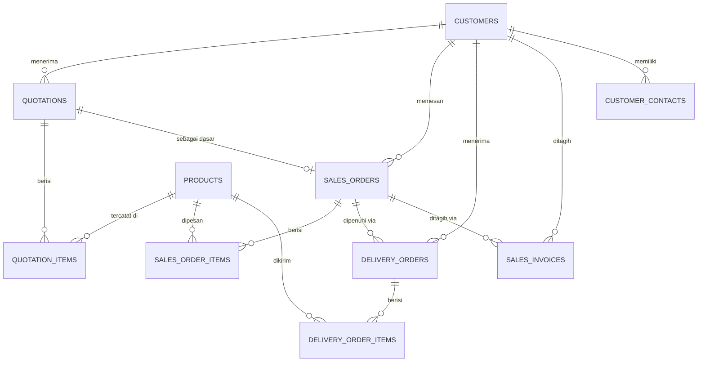

### B. ERD Modul Pembelian (Purchasing) & Pemasok
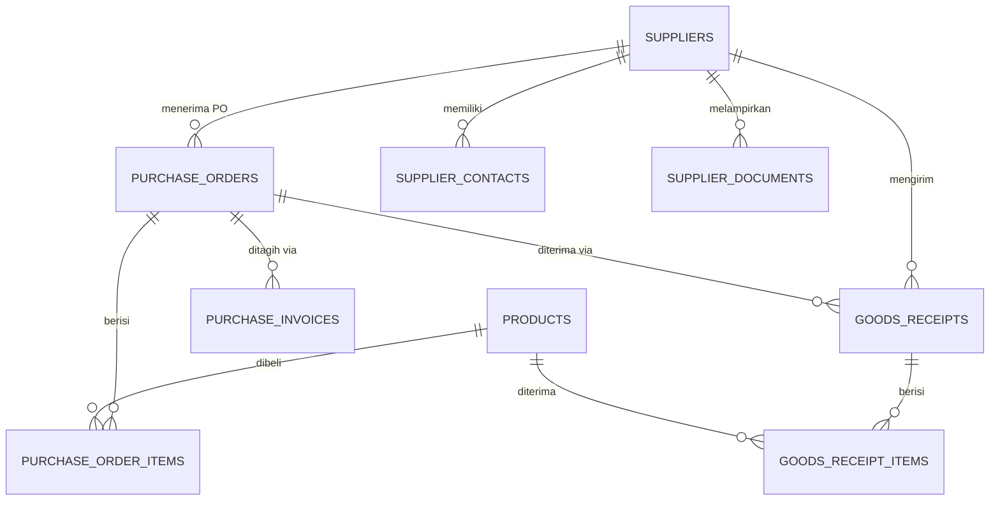

### C. ERD Modul Gudang (Inventory) & Pabrik (Manufacturing)
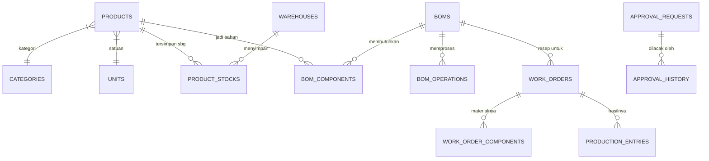

### D. ERD Modul General Affair (GA), Aset & Armada Kendaraan
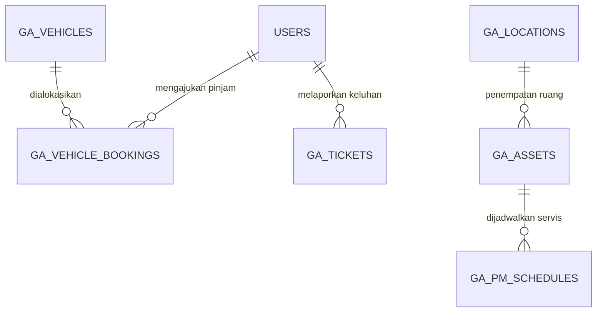

### E. ERD Modul Sumber Daya Manusia (HR), Absensi & Rekrutmen
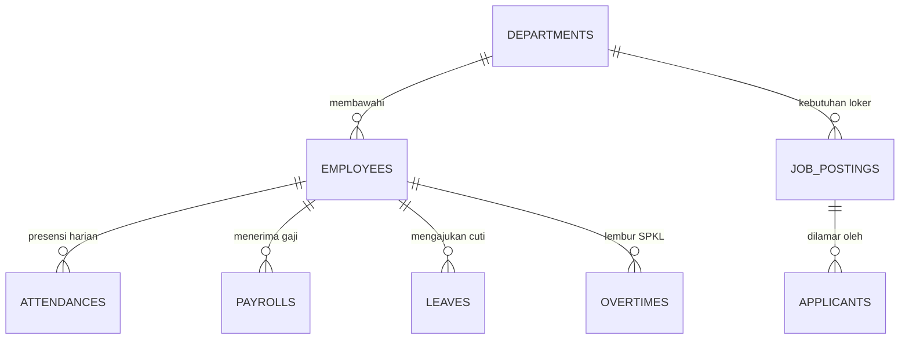

### F. ERD Modul Rapat (Meeting Command) & Notulensi AI
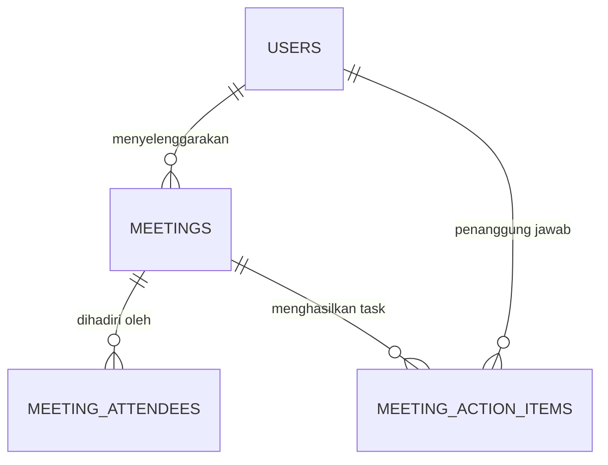

## 2.2 Ringkasan Tabel Berdasarkan Kategori

| Domain (Area) | Tabel Utama | Deskripsi Singkat |
|---|---|---|
| **Inti Sistem** | `users`, `companies`, `document_numbering` | Otentikasi login, profil PT, nomor surat otomatis |
| **Gudang (Inventory)** | `products`, `categories`, `units`, `warehouses`, `product_stocks`, `stock_movements`, `stock_adjustments`, `stock_opnames` | Data barang, satuan, pencatatan masuk-keluar & opname |
| **Penjualan (Sales)** | `customers`, `customer_contacts`, `quotations`, `quotation_items`, `sales_orders`, `sales_order_items`, `delivery_orders`, `delivery_order_items`, `sales_invoices`, `sales_invoice_items`, `sales_returns` | Siklus penjualan dari PO Masuk sampai Tagihan & Retur |
| **Pembelian (Purchasing)** | `suppliers`, `supplier_contacts`, `purchase_requests`, `purchase_orders`, `purchase_order_items`, `goods_receipts`, `goods_receipt_items`, `purchase_invoices`, `purchase_returns`, `rfqs` | Pembelian barang dari pengajuan, PO, penerimaan, sampai retur |
| **Pabrikasi (Manufacturing)** | `boms`, `bom_components`, `bom_operations`, `work_orders`, `work_order_components`, `production_entries`, `material_consumptions`, `subcontract_orders` | Resep produksi (BOM), Perintah Kerja, Pencatatan Bahan Baku, dan Titip Cetak |
| **Kualitas (QC)** | `qc_inspections`, `qc_inspection_items`, `qc_master_points`, `non_conformance_reports`, `coa_documents` | Standar inspeksi mutu dan sertifikat lolos uji |
| **Keuangan (Finance)**| `sales_invoices`, `purchase_invoices`, `purchase_payments`, `tax_rates` | Catatan utang & piutang, bukti pembayaran, tarif pajak |
| **SDM (HR)** | `employees`, `departments`, `positions`, `attendances`, `payrolls`, `payroll_items`, `shifts` | Karyawan, jabatan, absen sidik jari/Mesin, dan penggajian |
| **Logistik** | `vehicles`, `delivery_schedules`, `locations` | Armada truk dan penjadwalan ekspedisi |
| **Pemeliharaan** | `machines`, `maintenance_schedules`, `maintenance_logs`, `spareparts` | Jadwal servis mesin produksi & perbaikan alat |
| **Proyek (Projects)** | projects, project_tasks, project_members, 	ask_members | Manajemen pekerjaan per proyek & penugasan personil |
| **Hub. Pelanggan (CRM)** | whatsapp_messages, whatsapp_templates, email_messages, leads, opportunities, sales_visits | Kotak masuk WA/Email AI, prospek leads, dan GPS canvassing sales |
| **General Affair (GA)** | ga_assets, ga_tickets, ga_pm_schedules, ga_vehicles, ga_vehicle_bookings, ga_locations, ga_purchase_requests | Inventaris gedung, tiket keluhan, servis fasilitas, dan pinjam mobil dinas |
| **Meeting Command** | meetings, meeting_attendees, meeting_action_items | Notulensi rapat AI, check-in QR peserta, papan tugas action items |
| **Fasilitas & CCTV** | cctv_devices, cctv_channels | Streaming multi-kamera CCTV video wall gudang & workshop |
| **Bel Pabrik (Bell)** | ell_schedules | Jadwal bel pergantian shift & alarm otomatis terintegrasi Bell Agent |
| **Helpdesk IT** | helpdesk_tickets, helpdesk_ticket_replies | Ticketing bantuan teknis komputer & komplain operasional internal |
| **Rekrutmen (ATS)** | job_postings, pplicants | Penayangan lowongan kerja publik & tracking seleksi kandidat |
| **Portal Rekanan** | portal_users, portal_documents | Akses vendor luar untuk PO, Surat Jalan mandiri, faktur tagihan |
| **Logistik & Armada** | ehicles, delivery_schedules, locations, 	raccar_devices | GPS satelit Traccar, rute pengiriman, kiosk TV antrian gerbang |
| **Mesin Evaluasi** | pproval_requests, pproval_history, workflows, workflow_steps, pp_settings | Pengaturan tahapan persetujuan bertingkat (Mekanisme ACC dokumen) |

---

# 3. Spesifikasi Modul & Alur Kerja (Workflows)

## 3.1 Modul Penjualan (Sales)

### Fitur Utama
- **Pelanggan (Customers)**: Database lengkap pelanggan beserta daftar kontak (PIC).
- **Penawaran Harga (Quotations)**: Membuat proposal penjualan, bisa diubah statusnya (Diterima/Ditolak).
- **Pesanan Jual (Sales Orders)**: Dibuat manual atau ditarik otomatis dari Quotation yang Diterima.
- **Surat Jalan (Delivery Orders)**: Proses pengiriman (bisa parsial/sebagian). Jika sudah selesai, **stok di gudang langsung berkurang**.
- **Faktur Penjualan (Sales Invoices)**: Membuat tagihan lengkap dengan Pajak/PPN.
- **Retur Jual**: Mencatat barang yang dikembalikan.
- **AI PO Extractor**: Bot AI yang bisa membaca file PDF dari pelanggan lalu mengubahnya menjadi format Pesanan Jual secara otomatis.

### Alur Status (Workflow)

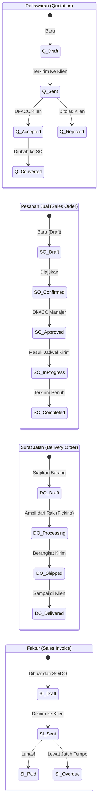

### Kemampuan Integrasi Excel
| Modul | Bisa Diimpor? (Import) | Bisa Diekspor? (Export) | Tersedia Format Data Lama? | Dukungan Tindih Data (Overwrite)? |
|---|:---:|:---:|:---:|:---:|
| Quotations (Penawaran) | ✅ | ✅ | ✅ | ✅ |
| Sales Orders | ✅ | ✅ | ✅ | ✅ |
| Delivery Orders | ✅ | ✅ | ✅ | ✅ |
| Sales Invoices| ✅ | ✅ | — | — |
| Pelanggan & Kontak | ✅ | ✅ | ✅ | ✅ |

---

## 3.2 Modul Pembelian (Purchasing)

### Fitur Utama
- **Pemasok (Suppliers)**: Database vendor, daftar kontak, dan penyimpanan berkas NPWP/NIB, dll.
- **Permintaan Pembelian (Purchase Requests)**: Pengajuan permohonan beli barang dari divisi internal.
- **Pesanan Beli (Purchase Orders - PO)**: Dokumen pembelian resmi yang dikeluarkan ERP ke supplier.
- **Tanda Terima Barang (Goods Receipts - GRN)**: Catatan pintu masuk gudang. **Menambah jumlah stok fisik**.
- **Faktur Pembelian**: Mencatat tagihan supplier ke kita.
- **Retur Beli**: Mengembalikan produk cacat ke supplier.

### Alur Status (Workflow)

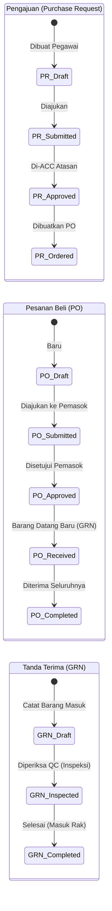

### Kemampuan Integrasi Excel
| Modul | Bisa Diimpor? (Import) | Bisa Diekspor? (Export) | Tersedia Format Data Lama? | Dukungan Tindih Data (Overwrite)? |
|---|:---:|:---:|:---:|:---:|
| Pemasok & Kontak | ✅ | ✅ | ✅ | ✅ |
| Purchase Requests | ✅ | ✅ | ✅ | ✅ |
| Purchase Orders | ✅ | ✅ | ✅ | ✅ |
| Goods Receipts | ✅ | ✅ | ✅ | ✅ |
| Alias Produk (Partner) | ✅ | ✅ | ✅ | ✅ |

---

## 3.3 Modul Stok Gudang (Inventory)

Modul ini adalah pusat dari seluruh persediaan bernilai finansial. Semua interaksi keluar-masuk barang pada dasarnya akan bermuara pada pencatatan otomatis di sini.

### Fitur Utama & Struktur Database
- **Produk (Products)**: Mewakili master SKU. Produk memiliki berbagai metrik dasar (kategori, satuan ukuran/Units, dimensi hitung minimum, titik pemesanan ulang/reorder point).
- **Gudang (Warehouses) & Lokasi (Locations)**: Mendukung tata letak penyimpanan multi-gudang (lokasi fisik cabang) dan lokasi spesifik (Rak/Baris).
- **Mutasi Stok (Stock Movements)**: Jantung pelacakan stok. Setiap perubahan kuantitas produk akan tercatat secara permanen di sini (kolom `balance_before` dan `balance_after`). 
  - **Tipe Mutasi (Sesuai Kode Sistem)**: `po_receive` (Terima PO), `so_delivery` (Kirim SO), `production_in` (Pemakaian Pabrik), `production_out` (Hasil Pabrik), `transfer` (Pindah Gudang), `adjustment` (Koreksi), `opname` (Audit), `purchase_return` & `sales_return` (Retur), dan `correction`.
- **Penyesuaian Stok (Stock Adjustments)**: Sarana untuk koreksi manual jika ada selisih di hari-hari biasa. Memiliki 3 status (`draft`, `completed`, `cancelled`).
- **Opname Gudang (Stock Opnames)**: Sarana untuk pencocokan fisik di akhir periode finansial. Status perjalanannya lebih disiplin (`draft`, `in_progress`, `completed`, `cancelled`).
- **Kamus Alias Produk**: Membantu mengubah/menyatukan penyebutan SKU yang kita pakai dengan cara Pemasok atau Pelanggan di dokumen mereka.

### Alur Status Spesifik: Koreksi Harian (Stock Adjustment)

Digunakan untuk perbedaan kecil seperti barang tumpah, susut, atau salah input.

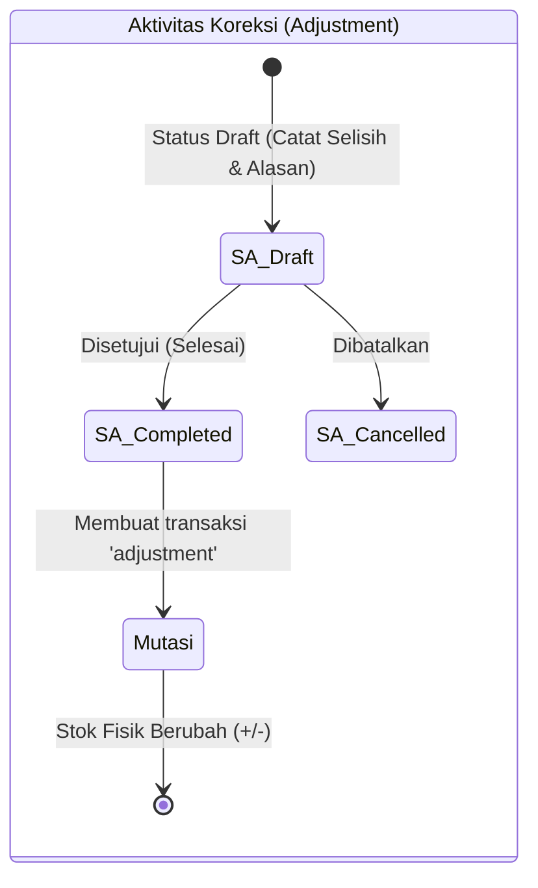

### Alur Status Spesifik: Audit Besar (Stock Opname)

Diberlakukan untuk penghitungan massal stok gudang, di mana data dari sistem di-bekukan sementara untuk dicocokkan dengan angka hitungan riil kru di lapangan.

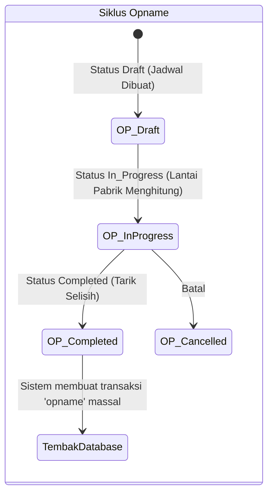

### Alur Integrasi Mutasi Stok ke Modul Lain

Sistem tidak perlu diperintah untuk mengubah angka di Kartu Stok. Ini 100% dipicu oleh aksi-aksi dokumen lain:

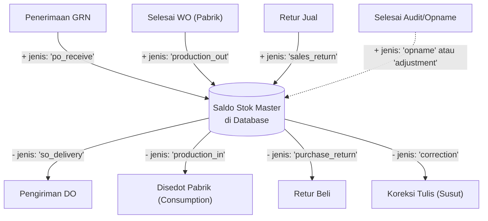

---

## 3.4 Modul Pabrikasi (Manufacturing)

Pabrikasi adalah serangkaian proses meramu/mengurai Bahan Baku (*Raw Materials*) hingga lahir menjadi Barang Setengah Jadi (*WIP*) atau Barang Jadi (*Finished Goods*) menggunakan Mesin Pabrik.

### Resep Formulasi: Bill of Materials (BOM)
BOM adalah jantung dari seluruh instruksi pembuatan produk.
- **Isi BOM:** Terdiri dari Produk Tujuan, Kuantitas Sasaran, dan Versi Resep (`version`).
- **Komponen Bahan (BOM Components):** Bahan apa saja yang dibutuhkan secara proporsional.
- **Tahap Operasional Mesin (BOM Operations):** Mesin apa yang dipakai, urutan proses, durasi pemrosesan.
- **Rumus Harga Pokok Produksi (HPP Standar) di Sistem:** 
  > *Total Standard Cost = Total Material Cost + Total Labor Cost + Total Machine Cost*
- **Status BOM:** Terdiri dari `draft`, `active` (siap produksi), dan `archived` (resep lawas diganti baru).

### Proses Pabrik: Perintah Kerja (Work Orders - WO)
SPK (Surat Perintah Kerja) adalah dokumen turun lapangan dari Manajer Produksi untuk mulai meracik BOM.
- **Atribut Penting WO:** Level Prioritas (`low`, `normal`, `high`, `urgent`), Tanggal Mulai dan Berakhir (Rencana vs Aktual).
- **Properti:** Tipe Produksi (`production_type`) dapat menampung opsi in-house atau sub-kontraktor (`Subcontract Orders`) ke pemasok (*supplier_id*).

### Pencatatan Dinamis Pabrik: Consumption & Production
Sebagai pengganti sistem analog, operator menggunakan dua interwajah:
1. **Material Consumption**: Setiap kali pekerja menyedot gudang untuk mengambil Bahan Baku, sistem otomatis mengurangi master gudang (tipe mutasi `production_in`) dengan rasio Harga Modal ter-kunci. Membutuhkan Input Nomor *Batch* dan Shift Kerja.
2. **Production Entry**: Mencatat pelaporan Jam Mesin bahwa suatu produk berhasil tercetak ("Lapor Jadi").
   - **Kategori Sukses & Tolak**: Memilah hasil antara *Qty Good* dan *Qty Rejected*.
   - **Kategori Defect / Cacat**: Sistem mengunci alasan ditolak (`dimensional`, `surface`, `material`, `assembly`, atau `other`).
   - **Shift Operator**: Opsi (`Shift 1, 2, 3`).

### Alur Status Spesifik: Siklus Perintah Kerja (WO Workflow)

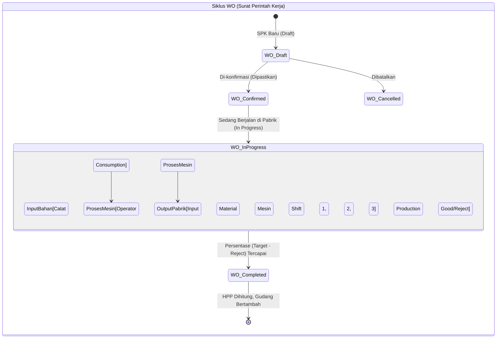

### Transisi Akuntansi Stok pada penyelesaian WO
Ketika sebuah Work Order di-klik **Complete (Selesai)**, sistem secara otomatis:
1. Menjumlah total Rupiah dari semua *Material Consumption* (Harga Bahan Mentah).
2. Membagi Rupiah tersebut berdasarkan nilai bersih barang bagus (*Good Qty*).
3. Melakukan injeksi stok (*Stock Adjustment* masuk) ke Gudang Finished Goods dengan Tipe Mutasi `production_out`, sekaligus membawa Nilai Biaya Rata-Rata Produksi (`avg_cost`) terbaru ke kartu stok. Peningkatan visibilitas margin keuntungan.

---

## 3.5 Modul Kualitas (Quality Control / QC)

- Terhubung dengan modul Gudang dan Pabrikasi. Bisa di-*setting* agar barang yang diterima harus di-inspeksi standarnya dulu (dimensi, berat, cat, dsb) sebelum sah bertambah menjadi stok yang bisa dijual.
- Ada fasilitas pembuatan Sertifikat Kualitas Laboratorium (Certificate of Analysis / COA). 

---

## 3.6 Modul Keuangan, Akuntansi & Analisis Biaya (Costing)
- **General Ledger (Buku Besar)**: Penjurnalan entri otomatis dari mutasi GRN, DO, Invoice, serta entri jurnal manual berpasangan.
- **Bank Reconciliation (Rekonsiliasi Bank)**: Import rekening koran (format CSV/Excel) dengan pencocokan otomatis transaksi penerimaan/pengeluaran kas dan bantuan AI Pattern Matching.
- **AP & AR Monitoring**: Pemantauan umur piutang (*aging schedule* 30, 60, 90 hari) dan penjadwalan pembayaran utang supplier.
- **Advanced Costing Module**:
  - *Production Costing*: Penghitungan HPP per Work Order berbasis biaya aktual bahan baku, tenaga kerja langsung, dan jam mesin.
  - *Overhead Allocation*: Distribusi biaya operasional tidak langsung (listrik pabrik, utilitas, depresiasi).
  - *Profitability Analytics*: Analisis margin keuntungan kotor dan bersih per lini produk dan per pelanggan.

---

## 3.7 Modul Human Resources (HR), Biometrik & Employee Self-Service (ESS)
- **Employee Master & Pendaftaran Face ID**: Profil karyawan lengkap dengan registrasi embedding wajah biometrik nir-sentuh.
- **Attendance Kiosk & Smart Attendance**: Presensi tablet di pos sekuriti serta clock-in berbasis verifikasi kamera dan geofencing.
- **Jadwal & Shift Kerja**: Pengaturan shift fleksibel, rotasi mingguan, toleransi jam keterlambatan, dan formula denda pinalti otomatis.
- **Payroll System**: Perhitungan gaji otomatis komponen gaji pokok, tunjangan kehadiran, BPJS Ketenagakerjaan/Kesehatan, PPh 21, potongan keterlambatan, serta rilis slip gaji PDF dan via WhatsApp.
- **Employee Self-Service (ESS Portal)**:
  - Portal karyawan mandiri di mobile/desktop (/employee/*).
  - Pengajuan cuti (*My Time-Off*), lembur (*My Overtime*), dan klaim biaya (*My Reimbursements*).
  - Pemantauan KPI dan rapor kinerja berkala (*My Performance*).
- **Rekrutmen & ATS**:
  - Penayangan lowongan kerja di Portal Karir Publik (/careers).
  - *Applicant Tracking System*: Seleksi berkas CV, tahapan wawancara, dan penawaran kerja (Offering).

---

## 3.8 Modul General Affair (GA), Aset Gedung & Peminjaman Kendaraan

### Alur Status Peminjaman Mobil Dinas (Vehicle Booking Workflow)
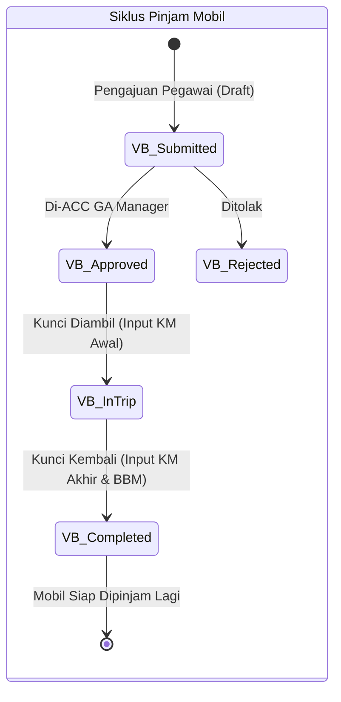
- **GA Ticketing**: Sistem pelaporan perbaikan fasilitas kerja (AC, kelistrikan, air, furnitur) dari karyawan dengan status eskalasi.
- **Aset Kantor (GA Assets)**: Inventarisasi perlengkapan kantor non-produksi beserta penomoran tag barcode dan lokasi ruangan.
- **Preventive Maintenance (PM) Fasilitas**: Kalender servis berkala lift, genset, AC kantor, dan fasilitas gedung.
- **Peminjaman Kendaraan Operasional (Vehicle Booking)**:
  - Formulir pengajuan izin pinjam mobil/motor operasional kantor.
  - Alur persetujuan atasan dan serah terima kunci.
  - Pencatatan odometer (kilometer awal vs akhir) dan verifikasi bukti BBM.

---

## 3.9 Modul Meeting Command & AI Notulensi (MoM)

### Alur Kerja Notulensi & Papan Tugas Rapat (Meeting Workflow)
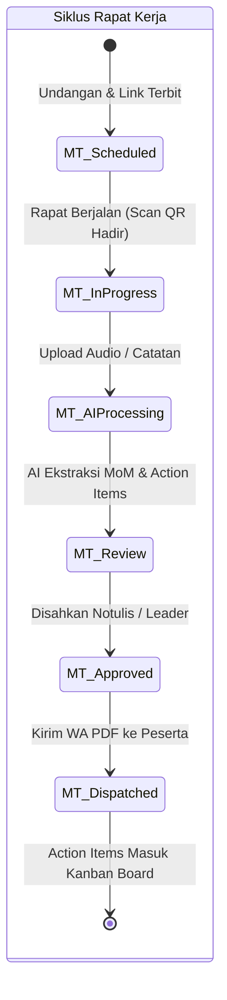
- **Sentralisasi Rapat**: Penjadwalan agenda rapat, ruangan, dan link video conference.
- **Presensi Digital**: Peserta rapat melakukan check-in mandiri melalui pemindaian QR-Code di layar proyektor atau ponsel.
- **AI Audio Transcription & Summary**:
  - Memproses rekaman audio rapat atau transkrip teks langsung menggunakan integrasi Google Gemini.
  - Menghasilkan ringkasan eksekutif, keputusan penting, dan daftar tugas lanjutan (*Action Items*) secara instan.
- **Action Items Kanban Board**: Manajemen tugas tindak lanjut rapat dengan antarmuka seret-lepas (*drag-and-drop*).
- **Distribusi Notifikasi**: Pengiriman otomatis hasil notulensi resmi (MoM PDF) ke grup atau nomor WhatsApp peserta rapat.

---

## 3.10 Modul Fasilitas, Live Streaming CCTV & Helpdesk

### Alur Tiket Bantuan Teknis IT (Helpdesk Lifecycle)
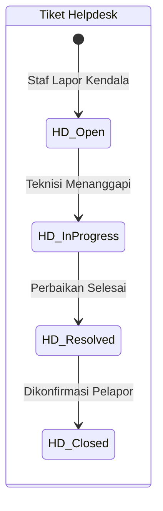
- **Video Wall CCTV (Live Surveillance)**:
  - Antarmuka pemantau video multi-channel di pos sekuriti atau ruang command center.
  - Menampilkan stream RTSP/HLS dari kamera pengawas area pabrik, gudang bahan baku, dan gerbang loading.
  - Pengambilan snapshot visual insiden secara instan.
- **Helpdesk Support**:
  - Ticketing bantuan teknis IT (gangguan internet, PC mati, instalasi software, eror ERP).
  - Alur percakapan terpadu antara staf pelapor dan teknisi IT pendamping.

---

## 3.11 Modul Driver Mobile & Portal Rekanan (Supplier Portal)

### Alur Supir & Bukti Serah Terima Pengiriman (Proof of Delivery - POD)
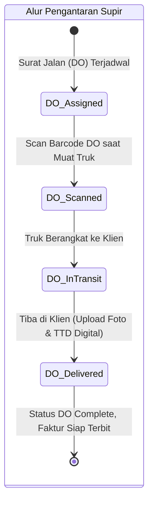
- **Aplikasi Ponsel Supir (Driver Mobile App)**:
  - Antarmuka supir truk logistik untuk melihat rute pengiriman harian.
  - Pemindai barcode surat jalan DO menggunakan kamera HP saat menaikkan muatan ke bak truk.
  - Tombol konfirmasi tiba (*Proof of Delivery*) lengkap dengan foto serah-terima dan tanda tangan digital penerima.
- **Portal Pemasok (Supplier Portal)**:
  - Akses aman bagi vendor eksternal untuk memeriksa pesanan resmi (PO) yang masuk.
  - Fitur *Acknowledge* (kesanggupan mengirim) atau *Reject* PO secara real-time.
  - Pembuatan Surat Jalan Vendor secara mandiri sebelum truk dikirim ke pabrik.
  - Pengunggahan berkas faktur/invoice dan kwitansi tagihan online untuk mempercepat verifikasi pembayaran.

---

## 3.12 Modul Sistem Bel Pabrik Otomatis (JICOS Bell Agent)
- **Pengaturan Jadwal Bel (Bell Schedules)**:
  - Konfigurasi waktu bel harian pabrik (Masuk Kerja, Istirahat Shift 1/2/3, Masuk Kembali, Bel Pulang, Alarm Darurat Evakuasi).
  - Penetapan nada suara (chime audio MP3/WAV) per kategori acara.
- **JICOS Bell Agent Desktop Client (pps/bell-agent)**:
  - Layanan latar belakang (*background service*) Python dengan system tray icon (pystray).
  - Terpasang di komputer pabrik yang tersambung kabel audio ke amplifier/sound system workshop.
  - Melakukan sinkronisasi jadwal secara periodik melalui endpoint /api/bell-agent/schedules.
  - Beroperasi independen secara offline menggunakan cache lokal jika koneksi internet terputus.

---

## 3.13 Modul Manajemen Proyek (Project Matrix)
- **Pelacakan Proyek**: Monitoring linimasa penyelesaian proyek internal dan instalasi lini mesin baru.
- **Manajemen Tugas (Kanban Tasks)**: Pembagian deliverable, alokasi PIC tim, checklist sub-task, dan lampiran berkas teknis.

---

## 3.14 Modul Logistik Lanjutan (Fleet Tracking GPS & Kiosk TV)
- **Integrasi GPS Satelit Traccar**: Pelacakan posisi koordinat real-time seluruh armada truk ekspedisi di peta satelit.
- **Logistics Kiosk TV**: Layar antrian interaktif di pos gerbang pabrik untuk menampilkan giliran truk sandar di dermaga bongkar muat (*Docking Gate*).

---

# 4. Dokumentasi Rute URL (API Routes)

(Ini berguna bagi programmer untuk melihat pola penamaan tautan)
Secara keseluruhan sistem kita punya 30+ "Rumah Besar" / Grup Menu yang mengikuti fungsi CRUD (Create, Read, Update, Delete) laravel yang seragam.

### 4.1 Standar RESTful Resource Routes
| Pola URL | Aksi yang Terjadi | Penjelasan Layar |
|---|---|---|
| `GET /namamodul` | `index` | Menampilkan Daftar Tabel (Pencarian & Halaman) |
| `GET /namamodul/create` | `create` | Membuka Formulir Tambah Data Kosong |
| `POST /namamodul` | `store` | Proses Simpan Data |
| `GET /namamodul/{id}` | `show` | Melihat Rincian Penuh Dokumen |
| `GET /namamodul/{id}/edit`| `edit`| Membuka Formulir Ubah/Edit Data |
| `PUT /namamodul/{id}` | `update` | Proses Update / Simpan Modifikasi |
| `DELETE /namamodul/{id}`| `destroy`| Soft Delete Data |
| `GET /.../template` | `template`| Download File Template Excel |
| `POST /.../import` | `import`| Upload & Baca File Excel Klien |
| `GET /.../export` | `export`| Unduh Rekap Data ke Format Excel |

### 4.2 Pemetaan Rute Grup Utama Sistem (22 Modul)
| Grup Modul | Awalan URL (Route Prefix) | Peran Pengguna Utama | Akses Antarmuka |
|---|---|---|---|
| **Penjualan & PO AI** | `/sales/*` | Sales Admin, Sales Manager | Web Desktop & Tablet |
| **CRM & Kunjungan** | `/crm/*` | Marketing, Sales Representative | Web & Mobile GPS |
| **Pembelian & Vendor** | `/purchasing/*` | Buyer, Procurement Manager | Web Desktop |
| **Gudang & Reklasifikasi**| `/inventory/*` | Warehouse Admin, Inventory Controller| Web & Barcode Scanner |
| **Pabrikasi & SPK** | `/manufacturing/*` | PPIC, Operator Shift, Engineering | Web & Kiosk Workshop |
| **Kualitas & Mutu** | `/qc/*` | QC Inspector, QA Manager | Web & Tablet Lab |
| **Logistik & Armada** | `/logistics/*` | Dispatcher, Logistics Planner | Web & TV Kiosk Gate |
| **Supir Pengiriman** | `/driver/*` | Supir Pengiriman Truk | Mobile Smartphone |
| **Portal Pemasok Luar** | `/portal/*` | Vendor Rekanan Eksternal | Web Eksternal Terisolasi |
| **Keuangan & Costing** | `/finance/*`, `/costing/*` | Finance AP/AR, Cost Accountant, CFO| Web Desktop |
| **SDM & Penggajian** | `/hr/*` | HR Admin, Payroll Officer | Web Desktop |
| **Employee Self-Service** | `/employee/*`, `/my-timeoff`| Seluruh Karyawan Kantor & Pabrik | Mobile Phone & Web |
| **Rekrutmen & Karir** | `/hr/recruitment/*`, `/careers`| HR Recruiter & Publik Umum | Web & Portal Terbuka |
| **General Affair** | `/general-affair/*` | GA Officer, Building Maintenance | Web Desktop & Mobile |
| **Meeting Command** | `/meeting-command/*` | Notulis, Project Leader, Direksi | Web, TV Wall & QR Mobile |
| **Fasilitas & CCTV** | `/facilities/*` | Security Head, Safety Officer | Kiosk Video Wall |
| **Helpdesk Internal** | `/helpdesk/*` | IT Support, Staf Pemohon | Web Desktop & Mobile |
| **Otomasi Bel Pabrik** | `/settings/bell-*`, `/api/bell-agent/*`| HR, PPIC, Python Desktop Daemon | Kiosk & Background Service |
| **Manajemen Proyek** | `/projects/*` | Project Manager, Engineer | Web Kanban Board |
| **Pengaturan Sistem** | `/settings/*`, `/admin/*` | Super Admin, IT Head, Auditor | Web Desktop Restricted |

---

# 5. Panduan Deployment & Infrastruktur Server

Bila kita ingin mengubah baris kode atau melakukan update untuk website produksi (*Live*).

## 5.1 Siklus Rilis Produksi Standar Enterprise (CI/CD Pipeline)

Untuk menjamin ketersediaan sistem pabrik tanpa downtime (*Zero-Downtime Deployment*), pembaruan kode produksi diatur secara terstruktur melalui pipeline CI/CD:

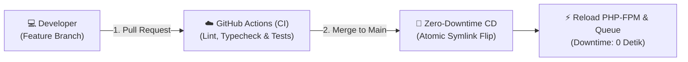

### Prosedur Rilis Produksi:
1. **Pemeriksaan Kualitas Otomatis**: Setiap *Pull Request* wajib lulus verifikasi `npx tsc --noEmit` (TypeScript), `./vendor/bin/pint --test` (Formatting), dan `php artisan test` (Unit/Feature Testing).
2. **Atomic Symlink Deployment**: Direktori baru disiapkan di `/var/www/erp/releases/TIMESTAMP`. Kompilasi aset frontend `npm run build` dan migrasi database dijalankan di direktori rilis baru. Saat siap, symlink `current` dialihkan dalam waktu < 1 milidetik sehingga pengguna aktif tidak mengalami *blank screen*.
3. **Pemberitahuan & Monitoring**: Health check otomatis di endpoint `/api/health` memverifikasi kesiapan database dan cache redis sebelum rilis dinyatakan stabil.
*(Lihat panduan lengkap di [`docs/cicd_and_release_management.md`](cicd_and_release_management.md))*.

## 5.2 Strategi Pencadangan & Pemulihan (Disaster Recovery & Backup)
- **Database Backup**: Pencadangan otomatis harian pukul 01:00 WIB via *mysqldump* terenkripsi AES-256 dan replikasi transaksi berjalan (*binary logs*) per 15 menit (RPO ≤ 15 menit, RTO ≤ 60 menit).
- **Off-site Sync**: Sinkronisasi berkas dokumen faktur, surat jalan, dan sertifikat QC ke *Off-site Cloud Storage*.
*(Lihat rincian prosedur darurat di [`docs/disaster_recovery_plan.md`](disaster_recovery_plan.md))*.

## 5.3 Manajemen Kredensial Rahasia (Environment / .env)
Daftar variabel rahasia yang tidak di-*commit* ke GitHub tapi harus ada di Server Live:

| Nama Konstanta | Fungsi Tujuannya |
|---|---|
| `DB_PASSWORD` | Kata sandi Database Server Live |
| `FONNTE_TOKEN` | Kunci API untuk mengirim Pesan WhatsApp Maskapai Otomatis |
| `WABLAS_TOKEN` | Alternatif lain untuk pesan WA |
| `GEMINI_API_KEY` | Kunci Berbayar / Gratis agar kemampuan Kecerdasan Buatan Bot (Pengekstrak Dokumen) bisa berjalan. |
| `MAIL_PASSWORD` | Kata sandi server Mail SMTP untuk mengirim konfirmasi tagihan ke pelanggan |

---

> **Dokumen disusun oleh**: Development Team (Antigravity & User)  
> **Terakhir diperbarui**: 21 Oktober 2026 (Enterprise Grade Specification)

---

# 6. Referensi Standar Arsitektur Enterprise

Untuk memenuhi kepatuhan tata kelola korporat, ketahanan sistem, dan integritas data industri, blueprint ini dilengkapi dengan dokumen spesifikasi teknis pendukung:

1. **[Kamus Data & Arsitektur Konkurensi Database (Data Dictionary)](data_dictionary_and_concurrency.md)**  
   *Spesifikasi struktur tabel inti, indeks performa tinggi, proteksi soft delete, dan penanganan race condition (pessimistic locking).*
2. **[Matriks Keamanan & Kontrol Akses Granular (Granular RBAC)](security_and_rbac_matrix.md)**  
   *Otorisasi dua lapis (Backend Policy + UI Guard), enkripsi data finansial/biometrik (UU PDP No. 27/2022), dan arsitektur immutable audit trail.*
3. **[Rencana Pemulihan Bencana & Keberlanjutan Sistem (DRP / BCP)](disaster_recovery_plan.md)**  
   *Standar SLA 99.9%, target RPO ≤ 15 menit & RTO ≤ 60 menit, strategi backup otomatis off-site, dan health check monitoring (`/api/health`).*
4. **[Spesifikasi Fungsional Rinci & Aturan Bisnis (FSD Teknis)](detailed_functional_specifications.md)**  
   *Aturan validasi limit kredit, alur 3-way matching pengadaan, formulasi HPP aktual BOM pabrikasi, dan auto-journaling akuntansi.*
5. **[Matriks & Skenario Uji Keberterimaan Pengguna (UAT Test Catalog)](uat_test_scenarios.md)**  
   *Katalog kasus uji terstruktur untuk validasi kelayakan serah-terima modul operasional pabrik dan keuangan.*
6. **[Panduan CI/CD & Manajemen Rilis Produksi (Release SOP)](cicd_and_release_management.md)**  
   *Git branching model, gerbang kualitas otomatis (CI), dan deployment nir-downtime (atomic symlink).*
7. **[Kontrak API & Standarisasi Komunikasi Data](api_contract_specification.md)**  
   *Standarisasi envelope JSON, katalog error code bisnis enterprise, dan webhook komunikasi pesan.*
